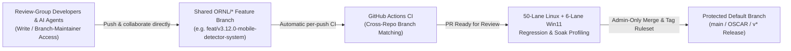

# OSCAR Architectural Roadmap, Governance & Feature Blueprints

This document provides the engineering roadmap, multi-repository collaboration rules, incorporated release ledger (`v3.10.0`–`v3.12.0`), and forward infrastructure roadmap for **OSCAR** across all 9 `ORNL/*` repositories. It is written for **both human developers and AI coding agents** (`Antigravity` / `Gemini`, `Codex`, `Claude Code`, `Cursor`, `GitHub Copilot`); pair it with [`../AGENTS.md`](../AGENTS.md), [`STORAGE_ARCHITECTURE.md`](STORAGE_ARCHITECTURE.md), and [`REGRESSION_AND_RELEASE_CERTIFICATION.md`](REGRESSION_AND_RELEASE_CERTIFICATION.md).

---

## 1. Live Tracking, Governance & Shared-Branch Workflow

### 1.1 GitHub Milestones & Project Board
Progress across **Incorporated** and **Planned** work is tracked in two synchronized surfaces:
1. **GitHub Milestones on `ORNL/oscar`:** <https://github.com/ORNL/oscar/milestones>
   - [**Milestone `#1` — Incorporated: `v3.10.0 – v3.11.15` Platform, Security & 50-Lane Scale Hardening**](https://github.com/ORNL/oscar/milestone/1)
     - [`ORNL/oscar#78`](https://github.com/ORNL/oscar/issues/78) — Incorporated Platform Baseline (`v3.10.0` – `v3.11.13`)
     - [`ORNL/oscar#79`](https://github.com/ORNL/oscar/issues/79) — Incorporated `OSCAR v3.11.14` & `v3.11.15` Multi-Repo Bugfix & 50-Lane Scale Hardening
   - [**Milestone `#2` — Incorporated in `v3.12.0`: Mobile Detector System (RS-350 & Kromek D5)**](https://github.com/ORNL/oscar/milestone/2)
     - [`ORNL/oscar#80`](https://github.com/ORNL/oscar/issues/80) — Cross-Repo Integration (`osh-oakridge-modules#57`, `oscar-viewer#49`, `oscar#76`, `osh-oakridge-modules#52`)
   - [**Milestone `#3` — Incorporated in `v3.12.0`: Opt-In Custom Widget Dashboards (`/dashboards`)**](https://github.com/ORNL/oscar/milestone/3)
     - [`ORNL/oscar#81`](https://github.com/ORNL/oscar/issues/81) — Additive Route, Global `AlarmAudio` & Resource-Cap Implementation (`oscar-viewer#50`, `oscar-viewer#46`)
   - [**Milestone `#4` — Incorporated in `v3.12.0`: Field Cutover & Operational Polish**](https://github.com/ORNL/oscar/milestone/4)
     - [`ORNL/oscar#74`](https://github.com/ORNL/oscar/issues/74), [`ORNL/oscar#75`](https://github.com/ORNL/oscar/issues/75), [`ORNL/oscar#77`](https://github.com/ORNL/oscar/issues/77), [`ORNL/osh-oakridge-modules#41`](https://github.com/ORNL/osh-oakridge-modules/issues/41), [`ORNL/osh-oakridge-modules#49`](https://github.com/ORNL/osh-oakridge-modules/issues/49), [`ORNL/oscar-viewer#44`](https://github.com/ORNL/oscar-viewer/issues/44)
   - [**Milestone `#5` — Incorporated in `v3.12.0`: Option A Storage, Multi-Year Cold Parquet CQL Count & 10-Year Scale Hardening**](https://github.com/ORNL/oscar/milestone/5)
     - [`ORNL/oscar#84`](https://github.com/ORNL/oscar/issues/84), [`ORNL/osh-addons#19`](https://github.com/ORNL/osh-addons/issues/19), [`ORNL/osh-addons#21`](https://github.com/ORNL/osh-addons/issues/21), & [`ORNL/osh-oakridge-modules#63`](https://github.com/ORNL/osh-oakridge-modules/issues/63) — Split-at-Export (`RAW_TELEMETRY` + `RAW_EVENTS -> DAILY_EVENTS -> MONTHLY_EVENTS`), 26 Summary Counters, Non-Blocking `< 60 s` Upgrade Migration, `O(1)` Overlay-Fingerprinted CQL Count Cache, and Per-Stream Vehicle Search Watermarks
   - [**Milestone `#6` — Self-Contained 50-Lane Regression Test Node Blueprint**](https://github.com/ORNL/oscar/milestone/6)
     - [`ORNL/oscar#87`](https://github.com/ORNL/oscar/issues/87) — Dedicated Bare-Metal Ubuntu Server 24.04 LTS 50-Lane Staging & Certification Runner (co-located emulators, `DOCKER-USER` LAN isolation, ZFS instant snapshots, `oscar-self-test`, Tailscale-ready)
2. **`ORNL` GitHub Projects v2 Kanban Board (`OSCAR Platform Roadmap & Release Tracker`):**
   - Synchronized deterministically from repository state via [`../tools/sync-project-board.mjs`](../tools/sync-project-board.mjs):
     ```bash
     gh auth refresh -h github.com -s project,read:project
     node tools/sync-project-board.mjs
     ```

### 1.2 Shared Branch-Maintainer Workflow (`Write` Access + Protected Default Branches)
To enable multiple developers and AI coding agents across the review group to collaborate without fork-sync bottlenecks while protecting 50-lane production stability:



- **Shared Branches Inside `ORNL/*`:** Review-group contributors (`Write` role) can create and push directly to non-default branches (`feat/*`, `fix/*`, `chore/*`) across all 9 `ORNL/*` repositories (`oscar`, `osh-core`, `osh-addons`, `osh-oakridge-modules`, `oscar-viewer`, `osh-js`, `oscar-regression`, `oscar-video-guides`, `oscar-federation-hub`).
- **Cross-Repository Branch Resolution:** When opening a coordinated PR across `ORNL/osh-oakridge-modules` and `ORNL/oscar`, name both branches identically (e.g., `feat/v3.12.0-mobile-detector-system`). [`ORNL/osh-oakridge-modules/.github/workflows/ci.yml`](https://github.com/ORNL/osh-oakridge-modules/blob/main/.github/workflows/ci.yml) automatically checks out the matching `ORNL/oscar` branch as its composite build root.
- **Admin-Only Merge & Release Authority:** Active GitHub Rulesets (`Protect default branch` and `Protect release tags`) enforce pull-request review, green required status checks, zero force-pushes, and Repository Admin merge/tag authority across all 9 default branches (`main`, `OSCAR`, `add-consys`) and `refs/tags/v*`.

---

## 2. Incorporated Architecture Ledger (`v3.10.0` – `v3.11.15`)

### 2.1 Core Platform & 50-Lane Scale Foundation (`v3.10.0` – `v3.11.13`, [`ORNL/oscar#78`](https://github.com/ORNL/oscar/issues/78))
- **`PARQUET_PRIMARY` Two-Tier Storage & DuckDB Federation (`STORAGE_ARCHITECTURE.md`):**
  - Eliminated unbounded PostgreSQL table/index bloat across 50-lane 1 Hz telemetry by routing all 22 operational/evidentiary streams through 30-minute stage partitions (`osg_*`) retired after SHA-256 parity to Hive-partitioned Zstandard Parquet generations, keeping `ONLY oscar.obs` at `~52` static rows (`~200 KiB`) and capping concurrent DuckDB cold-tier sessions at `2` (`DuckDbResourcePolicy`).
  - Added `FederatedObsStore` offset pushdown (`ORNL/osh-core#5`), `OscarTieredObsStore` shallow-offset non-cold completeness (`ORNL/osh-addons#14`), event-bounded live observation lookups (`ORNL/oscar-viewer#43`), and settled-count disjoint Priority bucket prewarm gating (`ORNL/oscar-viewer#45`).
- **Authentication, Passkeys & Zero-Trust Federation (`v3.11.0` – `v3.11.10`):**
  - Added WebAuthn Passkeys (`ES256`/`RS256`), unified `14`-character PBKDF2 password enforcement across UI/API/CLI (`ORNL/oscar-viewer#40`, `ORNL/osh-oakridge-modules#39/#40`), single-use QR user invites, scoped operational views (`?view=<scope>`), and `ORNL/oscar-federation-hub`.
- **Media, OCR, Cargo UFF, Edge Hardware & Guided Academy (`v3.11.0` – `v3.11.13`):**
  - Shipped embedded loopback `mediamtx` RTSP deduplication + keyframe-gated HLS (`LIVE_VIDEO.md`), 5-frame JPEG retained alarm media, crash-recoverable `DailyFileJournalService`, asynchronous PP-OCRv3 vehicle container/plate recognition, WCO UFF 2.0/3.0 Cargo NII SMB integration (`CARGO_UFF_INTEGRATION.md`), WebRelay gatekeeping (`LANE_WEBRELAY_GUIDE.md`), isolated `:8444` Hands-On Training Sandbox (`TRAINING_SANDBOX_GUIDE.md`), 4-locale (`en`, `es`, `fr`, `el`) manuals + `29` captioned MP4 guides (`VIDEO_GUIDES.md`), and Zero-Login GUI System Update.

### 2.2 `OSCAR v3.11.14` Multi-Repository Bugfix & Scale Hardening ([`ORNL/oscar#79`](https://github.com/ORNL/oscar/issues/79))

| Repository & Integration PR | Contributor PRs Integrated | Capability / Bugfix | 50-Lane Scale / Safety Refinement Applied |
| --- | --- | --- | --- |
| [`ORNL/osh-core#10`](https://github.com/ORNL/osh-core/pull/10) (`8c7d82a07`) | [`#6`](https://github.com/ORNL/osh-core/pull/6) (`@kalynstricklin`), [`#7`](https://github.com/ORNL/osh-core/pull/7) (partial, `@kalynstricklin`), [`#8`](https://github.com/ORNL/osh-core/pull/8) (`@mjd948`), [`#9`](https://github.com/ORNL/osh-core/pull/9) (`@mjd948`) | Guard null SensorML description (`#6`); stop Jetty handler dispatch once response is committed (`#8`, fixing [`ORNL/oscar#73`](https://github.com/ORNL/oscar/issues/73)); roll back failed driver registrations, guard variable-size SWE array resizing, and synchronize subsystem SensorML cloning (`#9`). | Added `DisplayUtils.escapeHtml` XSS escaping on Admin UI descriptions; ported idempotent same-system command-stream replacement in `InMemoryCommandStreamStore` (`#7`) while rejecting `#7`'s `log.warn` relaxation in `CommandStreamTransactionHandler` (which would cause duplicate command execution); isolated `TestHttpServer` onto ephemeral ports. |
| [`ORNL/osh-oakridge-modules#58`](https://github.com/ORNL/osh-oakridge-modules/pull/58) (`7a7324ae`) | [`#48`](https://github.com/ORNL/osh-oakridge-modules/pull/48) (`@kalynstricklin`), [`#54`](https://github.com/ORNL/osh-oakridge-modules/pull/54) (`@mjd948`), [`#55`](https://github.com/ORNL/osh-oakridge-modules/pull/55) (`@mjd948`), [`#56`](https://github.com/ORNL/osh-oakridge-modules/pull/56) (`@mjd948`) | Single-response session guard + case-insensitive sign-in (`#54`, [`ORNL/oscar#73`](https://github.com/ORNL/oscar/issues/73)); RS-350 silence socket rebuild, `HlsStreamHandler` `.ts` segment freshness, and duplicate video clip suppression (`#55`); `RpmRecoverySupervisor`, `ApplicationReadiness`, and late `WebId`/`OCR`/`EML` helper re-attach (`#56`, `#48`, closing `#45`, `#46`, `#50`, `#51`, `#53`). | Eliminated 1 Hz SWE `dataStruct.copy()` tree cloning in RS-350 `BackgroundOutput` & `ForegroundOutput` via reusable `liveDataStruct`; replaced coarse `synchronized` reconnect lock in `RS350Sensor` with non-blocking `connectionSwapLock`; removed unclosed wildcard `ModuleRegistry` listener in `Rs350OccupancyProcessModule` (`#48`) and extended `OccupancyProcessStarter` to await `initAsync = true` (`INITIALIZING -> INITIALIZED`) off the EventBus thread. |
| [`ORNL/oscar-viewer#51`](https://github.com/ORNL/oscar-viewer/pull/51) (`37b8de8`) | [`#47`](https://github.com/ORNL/oscar-viewer/pull/47) (`@mjd948`), [`#48`](https://github.com/ORNL/oscar-viewer/pull/48) (`@mjd948`) | Keep onboarding banner QR synchronized with re-issued invites (`#47`, [`ORNL/oscar#73`](https://github.com/ORNL/oscar/issues/73)); `30 s` detector-silence liveness (`deriveDeviceLiveness`), occupancy-scoped `WebIdAnalysis.tsx`, and `hls.js` `enableWorker: false` + `[5 s, 15 s, 30 s, 60 s]` auto-retry (`#48`). | Preserved `"unknown"` (`Waiting`) in `deriveDeviceLiveness` when neither `connectionStatus` nor device heartbeats have ever reported (and cleared cached `reportedRpmState` / heartbeat timestamps on missing-observation reconciliations); compensated for `> 2 s` NTP drift via HTTP `Date` headers; bounded `WebIdAnalysis.tsx` CQL queries by `resultTime` and gated fallback scans on `!exactFilterSucceeded`. |

### 2.3 `OSCAR v3.11.15` Tiered DuckDB Stream Lifecycle & Store Cursor Hardening ([`ORNL/oscar#79`](https://github.com/ORNL/oscar/issues/79))

| Repository & Integration PR | Contributor PRs Integrated | Capability / Bugfix | 50-Lane Scale / Safety Refinement Applied |
| --- | --- | --- | --- |
| [`ORNL/osh-addons#20`](https://github.com/ORNL/osh-addons/pull/20) (`c206a0a1`) | — | Lazy cold-tier Parquet & overlay cursor opening in `OscarTieredObsStore`. | Wrapped cold Parquet (`streamColdBases*`) and JDBC overlay (`streamOverlays`) streams in `OscarTieredObsStore.lazyStream(...)` and deferred upstream `Iterator` acquisition in `MergingIterator`, `MutationFilteringIterator`, and `ClosingLimitIterator` (`TestLazyTieredStreamLifecycle`) so `selectEntries`/`selectKeys` never acquires a `DuckDbResourcePolicy.Session` permit before terminal iteration reaches the cold tier. |
| [`ORNL/osh-oakridge-modules#61`](https://github.com/ORNL/osh-oakridge-modules/pull/61) (`eed1679c`) | [`#60`](https://github.com/ORNL/osh-oakridge-modules/pull/60) (`@mjd948`) | Close `WebIdHelper` observation lookup streams so they release DuckDB sessions (`#60`). | Added `.withLimit(1)` to both `WebIdHelper` `ObsFilter.Builder` lookups (`WebIdHelperStreamCloseTest`) and wrapped all remaining unclosed `IObsStore.select*` and `ISystemDescStore.select*` streams across `DatabasePurger`, `OccupancyDataRecorder`, RS-350 `MessageHandler`, `StatisticsOutput`, `OSCARServiceModule`, `TrainingSandboxManager`, and `LaneSystem` in `try-with-resources`. |

---

## 3. Incorporated `v3.12.0` Feature Tracks & Acceptance Gates

The `v3.12.0` release cycle delivers all four tracks below, certified against 50-lane Ubuntu Server 24.04 LTS and 6-lane Windows 11 + WSL 2 portals with multi-million-row archives. Every `v3.x.y` release sign-off requires an **unfiltered `./scripts/run-regression.sh full` (`28`-scenario) `PASS`** on the 50-lane Ubuntu 24.04 LTS certification portal plus Windows 11 + WSL 2 `full` certification and multi-host soak verification.

### 3.1 Track A — Mobile Detector System (`RS-350` Backpack & `Kromek D5` Walker)
- **Tracking Milestone & Issue:** [Milestone `#2`](https://github.com/ORNL/oscar/milestone/2) · [`ORNL/oscar#80`](https://github.com/ORNL/oscar/issues/80) (originating enhancement: [`ORNL/osh-oakridge-modules#52`](https://github.com/ORNL/osh-oakridge-modules/issues/52))
- **Active Draft PRs:** [`ORNL/osh-oakridge-modules#57`](https://github.com/ORNL/osh-oakridge-modules/pull/57) · [`ORNL/oscar-viewer#49`](https://github.com/ORNL/oscar-viewer/pull/49) · [`ORNL/oscar#76`](https://github.com/ORNL/oscar/pull/76)
- **Recommended Shared Branch Name (across all 3 repos):** `feat/v3.12.0-mobile-detector-system` (rebased onto `v3.11.15`+ `main`)
- **Quantified Multi-Year Scale Risk Prevented:** A single Kromek D5 walker emitting `1 Hz` 1,024-channel spectra plus `1 Hz` GPS (`LiveDriverLocationOutput`) generates `~63M` rows/year (`~365–500 GiB/year` per walker). Routing mobile outputs through `PARQUET_PRIMARY` stage partitions and `oscar_obs_latest` prevents hot PostgreSQL B-tree bloat in `ONLY oscar.obs`.

#### Required Architectural Refinements Before Merge
1. **Clean Rebase onto `v3.11.15` `main`:** Drop stacked `v3.11.14`–`v3.11.15` bugfix commits already merged on `main` (`#48` in `oscar-viewer`, `#55`/`#56`/`#60` in `osh-oakridge-modules`), keep the hardened `v3.11.15` implementations of `HLSVideoComponent.tsx`, `useLaneHealth.ts`, `WebIdAnalysis.tsx`, and `WebIdHelper.java`, and remove `.DS_Store`.
2. **Unified Async Submodule Lifecycle (`sensorhub-system-mobile`):**
   - Reuse [`OccupancyProcessStarter`](https://github.com/ORNL/osh-oakridge-modules/blob/main/sensors/sensorhub-system-lane/src/main/java/com/botts/impl/system/lane/helpers/occupancy/OccupancyProcessStarter.java) (which handles both synchronous `INITIALIZED` and `initAsync = true` `INITIALIZING -> INITIALIZED` occupancy modules off the EventBus thread) and [`RpmRecoverySupervisor`](https://github.com/ORNL/osh-oakridge-modules/blob/main/sensors/sensorhub-system-lane/src/main/java/com/botts/impl/system/lane/helpers/RpmRecoverySupervisor.java), and wrap all `IObsStore.select*` streams in `try-with-resources`.
   - Scope camera/HLS capability state to the `MobileDetectorSystem` instance (cleared in `doStop()`) rather than process-global static `ConcurrentHashMap` caches keyed by UID.
3. **`PARQUET_PRIMARY` Storage & Hot-Tier Allowlist Lockstep:**
   - Verify mobile stream routing across [`OscarTieredObsStore`](https://github.com/ORNL/osh-addons/blob/OSCAR/persistence/sensorhub-datastore-postgis/src/main/java/org/sensorhub/impl/datastore/postgis/store/obs/OscarTieredObsStore.java), [`dist/config/standard/config.json`](../dist/config/standard/config.json) (`archive.outputNames` if new cold stream names are introduced), and [`DatabasePurger`](https://github.com/ORNL/osh-oakridge-modules/blob/main/services/sensorhub-service-oscar/src/main/java/com/botts/impl/service/oscar/purge/DatabasePurger.java).
   - Continuous 1 Hz mobile GPS (`location` / `LiveDriverLocationOutput`), `ForegroundOutput`, `BackgroundOutput`, and D5 radiometric status **must never** accumulate unbounded rows in `ONLY oscar.obs`.
4. **Viewer Map, Audio & Localization Contracts (`ORNL/oscar-viewer#49`):**
   - Route mobile radiation alarms through the single global `AlarmAudio` instance in `src/app/Providers.tsx`.
   - Bound historical mobile GPS trail / breadcrumb queries by explicit `resultTime` / `phenomenonTime` window and page cap (`<= 500` points) and manage live streams through `SharedConnectionPool`.
   - Maintain 4-locale parity (`en`, `es`, `fr`, `el`) across `ConfigMessages*.properties` and Viewer `public/locales/*/*.json`.
5. **Simulator Packaging & Automated Regression (`ORNL/oscar#76` & `ORNL/oscar-regression`):**
   - Keep development simulators (`tools/mobile-simulators/` or `dev/` scripts) isolated from production `build/install/oscar` runtime bundles (`tools/validate-packaged-release.js`), add JUnit tests in `:sensorhub-system-mobile:test` (wired into `.github/workflows/ci.yml`), add Cypress component specs in `oscar-viewer`, and certify mixed `50` portal lanes + mobile walkers under `ORNL/oscar-regression` and `oscar-soak-test`.

---

### 3.2 Track B — Opt-In Custom Widget Dashboards (`/dashboards`)
- **Tracking Milestone & Issue:** [Milestone `#3`](https://github.com/ORNL/oscar/milestone/3) · [`ORNL/oscar#81`](https://github.com/ORNL/oscar/issues/81) (originating enhancement: [`ORNL/oscar-viewer#46`](https://github.com/ORNL/oscar-viewer/issues/46))
- **Active Draft PR:** [`ORNL/oscar-viewer#50`](https://github.com/ORNL/oscar-viewer/pull/50)
- **Recommended Shared Branch Name (in `ORNL/oscar-viewer`):** `feat/v3.12.0-custom-dashboards` (rebased directly onto `v3.11.15`+ `main`, unstacked from `#49` so both tracks can iterate independently)
- **Quantified Multi-Year Scale Risk Prevented:** In the initial draft of `ORNL/oscar-viewer#50`, `AlarmStatsRegistry` polled `50` per-lane unbounded `searchObservations` cursors plus `1,440` `/observations/count` requests every `300 s` (`POOL = 4`), which would permanently saturate the `2`-session `DuckDbResourcePolicy` cold-tier cap on 50-lane portals.

#### Required Architectural Refinements Before Merge
1. **Opt-In Additive Route Design (`/dashboards`):**
   - Adopt the opt-in additive route model offered on `ORNL/oscar-viewer#50`: preserve all **8 canonical ORNL routes** (`/`, `/map`, `/event-log`, `/lane-view`, `/report-view`, `/health`, `/servers`, `/users`) untouched as the default operator experience, and expose **Custom Dashboards** at `/dashboards` in `Navbar.tsx` using `scopedHref("/dashboards", activeView)`.
   - This guarantees zero breaking changes to operator muscle memory, the `26`-scenario `ORNL/oscar-regression` suite, the `54` localized manual screenshots, and the `29` `ORNL/oscar-video-guides` recordings.
2. **Safety-Critical Global `AlarmAudio` Invariant:**
   - Keep `<AlarmAudio />` mounted **exclusively** inside `src/app/Providers.tsx`. Never remove it from `Providers.tsx` or mount `<AlarmAudio />` inside per-widget components (which would mute radiation alarms when a user creates a dashboard without an alarm widget, or play overlapping audio when multiple alarm widgets exist). Visual alarm-queue widgets may subscribe to Redux alarm state without owning audio playback.
3. **50-Lane Browser & Backend Resource Guardrails:**
   - Enforce explicit per-dashboard widget caps: at most **`4` simultaneous live-video widgets** and **`6` simultaneous live-chart widgets** per active dashboard view, releasing all `SharedConnectionPool` leases immediately on tab switch or unmount.
   - Replace `AlarmStatsRegistry` client-side historical `searchObservations` / `1,440`-count polling with summarized server-side or bounded hot-state metrics (`0` periodic DuckDB cold scans).
4. **Scoped Views, State Versioning & 4-Locale Parity:**
   - Filter available lanes inside every dashboard widget through the active `?view=<scope>` operational view so gate-scoped operators only see permitted lanes.
   - Version the `redux-persist` slice cleanly (so upgrading existing browsers never crashes hydration), remove `.DS_Store`, complete `en`/`es`/`fr`/`el` locale catalogs (`npm run validate:locales`), and add Chrome Cypress component specs verifying widget CRUD, caps, and scoped-view filtering.

---

### 3.3 Track C — Multi-Year Cold Parquet CQL Count & Vehicle Search Scale (`O(1)` Warm Lookups)
- **Tracking Milestone & Issues:** [Milestone `#5`](https://github.com/ORNL/oscar/milestone/5) · [`ORNL/oscar#84`](https://github.com/ORNL/oscar/issues/84) · [`ORNL/osh-addons#21`](https://github.com/ORNL/osh-addons/issues/21) · [`ORNL/osh-oakridge-modules#63`](https://github.com/ORNL/osh-oakridge-modules/issues/63)
- **Recommended Shared Branch Name (across `ORNL/osh-addons`, `ORNL/osh-oakridge-modules`, `ORNL/oscar-viewer`, `ORNL/oscar`):** `feat/v3.12.0-parquet-cql-count-cache`
- **Empirical Motivation (30-Day 50-Lane `full` Regression & 8.4h Endurance on `v3.11.15`):**
  - Interactive filtered pages (`offset=0`, `offset=15`, and deep offsets up to `offset=1,500,000` across `1.90M` occupancies) settle in **`322–523 ms` (`O(1)`)**, and summarized filter counts (`gammaAlarm`, `neutronAlarm`, `adjudicatedIdsCount`, disjoint multi-`Status`, `base_summary_mask` windows) settle in **`< 5–50 ms` (`0` DuckDB sessions)**.
  - **Finding 1 — Unsummarized CQL `/observations/count` Over EML-Mutated Generations:** Unsummarized numeric/timestamp/text CQL `/observations/count` queries (such as `maxGamma >= 50` or `endTime > '<iso>'`) currently bypass `ParquetArchiveReader.unmutatedCqlCounts` whenever a sealed 30-minute Parquet generation has `>= 1` `Code 9999` EML or operator overlay (`excludedNav` hit). On 50-lane portals with EML enabled, over half of all sealed generations (`~2,300` of `4,456` at 30 days) have EML overlays, causing background counts to rescan `~2,300` Parquet files in DuckDB (`22.1 s` warm / `42.0 s` cold inside the `1`-session `cold-cql-count` lane).
  - **Finding 2 — `VehicleIncidentAggregator` Cache-Key Invalidation Rescan (`GET /buckets/adjudication/vehicle-search`):** `OcrSearchCacheSlot` and `AdjudicationSearchCacheSlot` currently key on `db + "|" + String.join(",", sortedStreamKeys)`. Enabling OCR on an additional lane (`Lane50` in `vehicle-ocr`) or querying a lane subset changes `sortedOcrKeys` and triggers a synchronous `Instant.MIN..Instant.MAX` `selectEntries` rescan across all `4,456` Parquet files (`> 30 s`), even when `Lane41..Lane49` are already cached in memory; in addition, `PROFILE_LOAD_PARALLELISM = 4` exceeds `DuckDbResourcePolicy`'s `2`-session ceiling.

#### Required Architectural Implementation Before Merge
1. **Overlay-Fingerprinted Per-Generation Count Cache (`ORNL/osh-addons#21` — `ParquetArchiveReader.java`):**
   - Extend `CqlGenerationCountKey` to include a compact deterministic digest of `genExcludedIds` (`(generation.sha256, normalizedDatastreamIds, cqlAstDigest, phenomenonWindow, resultCutoffBucket, genExcludedIdsDigest)`) rather than disqualifying generations that contain `excludedNav` overlays.
   - Because `genExcludedIds` for a sealed historical generation only changes on retroactive cold re-adjudications, EML-adjudicated generations become `99.9%+` cache-eligible (`< 50 ms` warm count, `0` DuckDB sessions).
2. **Generation Summary Numeric Upper-Bound Pruning (`oscar_archive_generation_summary`):**
   - Persist compact numeric upper bounds (`max_gamma_max`, `max_neutron_max`, `max_occupancy_duration_ms`) in `oscar_archive_generation_summary` (and prune `0`-alarm generations when combined with `Status = Gamma | Neutron`) so cold cache misses skip non-matching 30-minute Parquet files in memory before opening DuckDB.
3. **Per-Stream `VehicleIncidentAggregator` Cache Watermarks & `PROFILE_LOAD_PARALLELISM <= 2` (`ORNL/osh-oakridge-modules#63`):**
   - Key `OcrSearchCacheSlot` and `AdjudicationSearchCacheSlot` per `IObsSystemDatabase` (`db`) with per-stream watermarks (`Map<String, Instant>`) so dynamically added OCR lanes or scoped lane subsets reuse warmed streams in `0 ms` and scan only newly added streams (`< 5 ms`), avoid synchronous full-archive `slot.clear()` rescans inside HTTP request threads, and cap `PROFILE_LOAD_PARALLELISM` to `<= 2`.
4. **Viewer Count Coalescing & Abort Hygiene (`ORNL/oscar-viewer`):**
   - Abort superseded `/observations/count` `AbortController` requests cleanly on rapid filter/sort toggles and decouple DataGrid interactive row settlement from slow cold count badges.
5. **Split-at-Export (`RAW_EVENTS` + `RAW_TELEMETRY`), Event-Only Multi-Tier Parquet V2 Compaction, Bloom Filters, Projected Event Columns & 10-Year Scale Hardening (`ORNL/osh-addons`, `ORNL/osh-oakridge-modules`, `ORNL/oscar`):**
   - Split closed 30-minute `PARQUET_PRIMARY` stage windows directly at export via file-backed DuckDB + native `DuckDBAppender` into two complementary Parquet V2 profiles: **`RAW_EVENTS`** (the 9 searchable operational/evidentiary/summary streams, `~1.23%` of rows, 20 columns with 9 pre-extracted projected scalar columns, `ROW_GROUP_SIZE = 8192`, Split-Block Bloom filters at `0.01` FPR, 26 `oscar_archive_schema` summary counters, and selective 256-byte `ocr_bloom` + min/max bounds) and write-once **`RAW_TELEMETRY`** (all 17 remaining high-rate `1 Hz` telemetry/status/mobile streams including `dailyFile`, `connectionStatus`, `occupancyStatus`, `location`, and Kromek D5 streams, `~98.77%` of rows, 11 base columns, `ROW_GROUP_SIZE = 65536`, `128 MiB` uncompressed cap at `256 MiB` DuckDB memory, `ocr_bloom = NULL`, **`1.0x` write amplification, never rewritten**).
   - Restrict `ArchiveCompactionManager` strictly to event tiers (`RAW_EVENTS -> DAILY_EVENTS -> MONTHLY_EVENTS` + independent per-part monthly overlay defrag for `>= 64` settled overlays `>= 7d` old) with explicit rollover limits (`1,000,000` rows / `192 MiB` uncompressed with `2x` hard cap), overlapping source clustering, chunk-spilled streaming via `DuckDbResourcePolicy.ScratchDirectory` (`< 20 MiB` JVM heap, `<= 1` active DuckDB session), strictly disjoint `[window_start, window_end)` multi-part bounds, a `15m` `DELETING` unlink grace window, automatic self-healing cleanup of stale `>= 2h` unregistered `.partial` files, read-only compatibility with legacy `RAW_GATED` / `DAILY_TELEMETRY` archives, and `.tree`-manifest incremental USB backup invalidation.
   - Enforce `5 s` anti-starvation aging + `parquet_metadata_cache=true` in `DuckDbResourcePolicy`, day-by-day `sliceWideCluster` (`<= 16` files/batch, bypassed for homogeneous wide clusters with bounded SQL Top-N `LIMIT <= 1_024` so sparse monthly partitions execute in 1 DuckDB open), RFC-3339 temporal, `PropertyIsLike`, and cross-property `tamperStatus=true OR alarmState='Fault - ...'` summary pushdowns in `JsonCqlEvaluator`, chunked `ANY(?::uuid[])` (`<= 2,048`) summary lookups + `EVENT_QUERY_PROFILES` scoping + plain `?limit=N` row-count prefix slicing + `>= 256 MiB` bloat-gated `REINDEX TABLE CONCURRENTLY oscar_archive_schema` in `ArchiveCatalog`/`OscarTieredObsStore`, deferred-interrupt clean stop in `SlidingOccupancyQuery`, rolling `30-day` hot-window `OcrSearchCacheSlot` with cold CQL2 merge in `VehicleIncidentAggregator`, and zero-bloat EML `Code 9999` filtering in `AdjudicationSearchCacheSlot`.

---

### 3.4 Track D — Field Cutover & Operational Polish ([Milestone `#4`](https://github.com/ORNL/oscar/milestone/4))
- [`ORNL/oscar#75`](https://github.com/ORNL/oscar/issues/75) — **Legacy `v3.5` Camera RTSP Path Migration / Validation:** Detect legacy `remoteHost: "<ip>"` + `streamPath: ":9001/cam1"` configurations on load/import and normalize or warn clearly instead of constructing `rtsp://<ip>/:9001/cam1`.
- [`ORNL/oscar#74`](https://github.com/ORNL/oscar/issues/74) — **Non-443 Gateway Port-80 Redirect Polish:** HTTPS upstream `Host` preservation is already handled via `map $http_host $oscar_public_host` in [`dist/release/docker/gateway/default.conf`](../dist/release/docker/gateway/default.conf); evaluate optional custom HTTPS port propagation on the port-80 redirect when `OSCAR_HTTPS_PORT != 443`.
- [`ORNL/osh-oakridge-modules#41`](https://github.com/ORNL/osh-oakridge-modules/issues/41) — **SensorHub Admin Logout `continue` Target:** Preserve `continue=/sensorhub/admin` when signing out from `/sensorhub/admin`.
- [`ORNL/osh-oakridge-modules#49`](https://github.com/ORNL/osh-oakridge-modules/issues/49) — **`BucketService` Startup Readiness Tolerance:** Bound or retry `OSCARService` startup attachment cleanly if `BucketService` initialization exceeds `10 s` on cold disks.
- [`ORNL/oscar-viewer#44`](https://github.com/ORNL/oscar-viewer/issues/44) — **RS-350 Additional Status Indicators:** Evaluate RS-350-specific status indicators alongside `MobileDetectorSystem` (`#80`).

---

## 4. Planned (`v3.13.0` CI & Pre-Release Infrastructure — [Milestone `#6`](https://github.com/ORNL/oscar/milestone/6))

- [`ORNL/oscar#87`](https://github.com/ORNL/oscar/issues/87) — **Self-Contained Tailscale Bare-Metal 50-Lane Staging & Certification Runner for Maintainer `-dev` / `-rc` Pre-Releases:** Provision a dedicated bare-metal Ubuntu Server 24.04 LTS 50-lane staging host on a physically isolated ISP circuit connected via Tailscale (seeded with a ZFS/LVM-snapshotted 30+ day `PARQUET_PRIMARY` archive baseline, co-located 50-lane RPM/RTSP/Samba emulators, and local `ORNL/oscar-regression` execution) so maintainers with `Write` branch-management access can produce scale-certified `-dev` and `-rc` pre-releases while keeping `main` and production `v*` tags `Admin`-gated.
