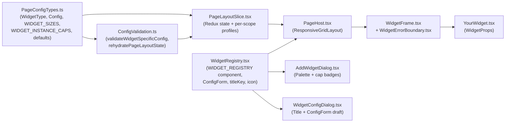

# OSCAR 3.12.1 Custom Widget Dashboards Guide (Operators, Administrators & Developers)

**Custom Widget Dashboards (`/dashboards`)** provide an opt-in, drag-and-drop 12-column workspace for control rooms, gatehouse wallboards, mobile-patrol command desks, and shift supervisors — without altering any of OSCAR's 8 canonical console routes (`/`, `/map`, `/event-log`, `/lane-view`, `/report-view`, `/health`, `/servers`, `/users`).

> **Companion Video Walkthrough:** Watch **[Module 32 — Build, Scope & Export Opt-In Custom Widget Dashboards (`32-custom-widget-dashboards.mp4`)](https://github.com/ORNL/oscar-video-guides/blob/main/videos/32-custom-widget-dashboards.mp4)** ([WebVTT captions](https://github.com/ORNL/oscar-video-guides/blob/main/captions/32-custom-widget-dashboards.vtt)) in [VIDEO_GUIDES.md](VIDEO_GUIDES.md#32-custom-widget-dashboards).

---

## Part 1 — Operator & Supervisor Guide (`/dashboards`)

### 1.1 Opening & Managing Custom Dashboards

1. **Open the workspace:** Click **Custom Dashboards** (mosaic `+` icon) in the left navigation drawer to open `/dashboards`.
2. **Choose a starter template or blank canvas:**
   - When the current scope has no custom pages yet (or when you click **Starter Templates** in the top switcher bar), OSCAR opens the **Starter Template Gallery**:
     - **Multi-Lane Wallboard (`multi-lane-wallboard`):** `1` full-width **Lane Status** strip, `4` live **Video Stream** tiles, and `4` real-time **Count Chart** tiles automatically bound to the first four discovered lanes in the active Operational View.
     - **Alarm & Map Overview (`alarm-map-overview`):** **Lane Status** tiles, interactive **Map** (fixed portals + mobile detector trails/alarm pins), **Quick View** side drawer, and live **Alarm Table**.
     - **Statistics Overview (`statistics-overview`):** Four preconfigured **Alarm Statistics** cards (**Rate trend**, **Lane comparison**, **Adjudication time**, and **Time profile**) refreshing at `300 s`.
     - **Dashboard (`dashboard`):** Editable version of the standard **Lane Status** + **Alarm Table** + **Quick View** workspace.
     - **Blank Page:** Empty 12-column canvas opened immediately in **Edit Layout** mode.
   - Clicking **Add Page** opens the full template picker (`11` named templates in total, adding **Lane View**, **Map**, **National**, **Events**, **State of Health**, **Report Generator**, and **Alarm Transfer** alongside the four featured cards above).
3. **Edit layout, move, resize, and configure widgets:**
   - Click **Edit Layout** in the dashboard toolbar to unlock dragging (via each tile's header drag handle), resizing (bottom-right corner handle), per-widget settings (gear icon), widget removal (`×` icon), and **Add Widget**.
   - Click **Done** to lock the grid against accidental drags during active alarm operations.
   - Grid coordinates adapt automatically across three responsive breakpoints:
     - `lg` (`>= 1200 px`): **12 columns**
     - `md` (`>= 900 px`): **8 columns**
     - `sm` (`< 900 px`): **4 columns**
     - Vertical step height: `40 px` row height + `8 px` margin (`48 px` per row unit; valid bounds `1 <= w <= 12`, `1 <= h <= 24`).
4. **Page settings, reset & drawer shortcuts:**
   - Open the three-dot page menu (`⋮`) to rename the dashboard or pick from `16` curated navigation icons (**Page Settings**), open **Import / Export**, restore a template-backed page to its original layout (**Reset to default**), or delete the page.
   - Saved pages with `showInNav !== false` appear automatically as one-click shortcuts under **Custom Dashboards** in the left navigation drawer (`/dashboards/?id=<page-id>`).

---

### 1.2 Complete 17-Widget Catalog

Every custom dashboard widget renders inside a standardized `WidgetFrame` protected by an isolated `WidgetErrorBoundary` (so a fault in one tile never crashes neighboring tiles):

| Widget Type ID | Default Title | Default / Min Grid Size (`lg` 12-col) | Config Form & Key Options | Lane Scoping Model | Per-Page Cap | Operational Role |
| :--- | :--- | :--- | :--- | :--- | :--- | :--- |
| `system-status` | **Lane Status** | `8 × 6` / `2 × 3` | `SystemStatusConfigForm` (`lanes`: all or selected subset) | Multi-lane (`LaneSelection`) | Unlimited | Compact real-time lane status, alarm, fault, and connection tiles |
| `map` | **Map** | `6 × 10` / `3 × 5` | `SystemStatusConfigForm` (`lanes`) + JSON/defaults for `showMobileUnits`, `showTrail`, `trailLength` (`300`), `showAlarmMarkers`, `alarmTimeWindow` (`today`/`1h`/`8h`/`24h`) | Multi-lane (`LaneSelection`) | Unlimited | Leaflet map with fixed lanes, mobile RS-350 / Kromek D5 live GPS trails, and color-coded mobile alarm pins |
| `event-table` | **Events** | `12 × 10` / `4 × 5` | `EventTableConfigForm` (column visibility/order across 10 columns + lane/status/adjudication/date filters) | Multi-lane (`LaneSelection`) | Unlimited | Full-database occupancy and alarm search table with widget-isolated filters |
| `adjudication-table` | **Alarm Table** | `12 × 10` / `4 × 5` | `EventTableConfigForm` (`adjudicatedIds` off by default to avoid eager row subqueries) | Multi-lane (`LaneSelection`) | Unlimited | Live active alarm queue with widget-isolated read/filter state (never overwrites canonical `/` unread watermark) |
| `video` | **Video Stream** | `4 × 8` / `2 × 4` | `LaneDetailStatusConfigForm` (`laneSource`: follow page or explicit lane; optional `streamId`) | Single-lane (`LaneSource`) | **`<= 4`** | Shared-lease live HLS lane camera viewer with multi-camera cycling and auto-retry |
| `chart` | **Count Chart** | `6 × 6` / `3 × 4` | `LaneDetailStatusConfigForm` (`laneSource`; optional `showThreshold`) | Single-lane (`LaneSource`) | **`<= 6`** | Live Gamma / Neutron real-time count-rate waveform |
| `lane-detail-status` | **Lane Status** *(Detail)* | `12 × 4` / `4 × 3` | `LaneDetailStatusConfigForm` (`laneSource`) | Single-lane (`LaneSource`) | Unlimited | Single-lane header status bar plus live `15`-line Daily File message feed |
| `status-table` | **Lane Log** | `12 × 10` / `4 × 5` | `StatusTableConfigForm` (`laneSource`, `defaultView`: `occupancy` or `fault`) | Single-lane (`LaneSource`) | Unlimited | Single-lane recent occupancy or `24h / 7d / 15d` fault log table |
| `rs350-spectrum` | **RS-350 / D5 Spectrum** | `12 × 16` / `6 × 7` | `LaneDetailStatusConfigForm` (`laneSource`) | Single-lane (`LaneSource`) | Unlimited | Live spectroscopic detector workspace supporting both **RS-350** (1,024-channel + WebID) and **Kromek D5** (4,096-channel) lanes |
| `alarm-stats` | **Alarm Statistics** | `6 × 8` / `3 × 5` | `AlarmStatsConfigForm` (`visualization`, `lanes`, `window`, `bucket`, visualization-specific toggles, `liveAppend`, `refreshSec`) | Multi-lane (`LaneSelection`) | Unlimited | Scale-safe statistical charts across 5 visualizations (see Section 1.3) |
| `quick-view` | **Quick View** | `4 × 16` / `3 × 7` | Title override only | Follows selected event | Unlimited | Side-by-side preview of the currently selected alarm/occupancy (retained 5-frame gallery, counts, quick adjudication) |
| `national-stats` | **National** | `12 × 11` / `6 × 6` | Title override only | Active Operational View | Unlimited | Embedded National View statistics rollup table across connected nodes |
| `state-of-health` | **State of Health** | `12 × 16` / `6 × 7` | Title override only | Active Operational View | Unlimited | Embedded Status of Health RPM/camera/fault/WebRelay matrix |
| `report-generator` | **Report Generator** | `12 × 18` / `6 × 8` | Title override only | Active Operational View | Unlimited | Embedded multi-format (`PDF`, `CSV`, `JSON`, `XLSX`) report generator |
| `alarm-transfer` | **Alarm Transfer** | `12 × 16` / `4 × 7` | Title override only | Active Operational View | Unlimited | Embedded offline QR / `.oscar-alarm.json` export and import workspace |
| `event-details` | **Event Details** | `12 × 20` / `6 × 10` | Title override only | Active selected event | Unlimited | Embedded full Event Details view (media gallery, waveform, spectroscopy, OCR, adjudication log) |
| `event-lookup` | **Event Lookup** | `6 × 4` / `3 × 3` | Title override only | Active Operational View | Unlimited | Compact Event UUID & Tier-1 lookup bar |

---

### 1.3 Configuring `Alarm Statistics` & `Event / Alarm Tables`

#### `Alarm Statistics` (`alarm-stats`) Visualizations
Open the gear icon on any `alarm-stats` widget in **Edit Layout** mode to choose among five visualizations:

1. **`rate-trend` (Rate Trend):** Plots occupancies, alarms, and right-axis alarm rate `%` over `1h`, `8h`, `24h`, or `7d` using `area` or `line` style and configurable buckets (`auto`, `1m`, `5m`, `15m`, `1h`, `6h`, `1d`).
2. **`lane-stack` (Alarms / Occupancies Stacked by Lane):** Time-bucketed stack showing the top `N` lanes individually (`1 <= laneStackTopN <= 7`) and folding remaining lanes into **Other**.
3. **`time-profile` (Hour-of-Day / Day-of-Week Profile):** Aggregates counts by `hourOfDay` (`1h` / `8h` / `24h` window) or `dayOfWeek` (`1h` / `8h` / `24h` / `7d` / `30d` window), normalized to mean per hour/weekday by default (`profileNormalize: true`). Uses SQL count pushdown over `<= 30` intervals at `POOL <= 2` concurrency (`liveAppend` disabled for profile mode).
4. **`adjudication-time` (Adjudication Time Distribution):** Histogram of alarm-to-adjudication duration with optional mean-time trend overlay (`showAdjMeanTrend`).
5. **`lane-comparison` (Lane Comparison & KPIs):** Horizontal bar chart and/or KPI summary strip comparing top `N` lanes (`laneCompareTopN`, default `15`) by `alarmRate`, `occupancies`, `alarms`, `adjudicatedPct`, or `meanAdjTime`.

**Refresh Cadence Rule:** `refreshSec` must be **`0`** (manual refresh only) or **`>= 60` seconds** (default `300 s`). Both `AlarmStatsConfigForm` and `ConfigValidation.ts` enforce this floor so dashboards cannot flood PostgreSQL or DuckDB on 50-lane portals.

#### `Event Table` & `Alarm Table` Columns
Both `event-table` and `adjudication-table` let you toggle visibility and reorder all `10` supported column keys (`laneId`, `occupancyCount`, `startTime`, `endTime`, `maxGamma`, `maxNeutron`, `status`, `adjudicatedIds`, `adjudicationCode`, `vehicleId`) plus scope rows to specific lanes. On `adjudication-table`, `adjudicatedIds` starts hidden by default to prevent eager per-row adjudication subqueries on busy portals.

---

### 1.4 Per-Operator & Per-Operational-View Scoping

Custom dashboards are persisted in browser storage (`redux-persist` `pageLayoutSlice`) keyed by `(username, activeViewKey)` via `buildLayoutScopeKey`:

- Switching users (`operator-a` vs. `admin`) or switching the top-bar **Scoped View** (`?view=north-gate` vs. `?view=south-gate` vs. unscoped **All Lanes**) automatically switches to that scope's isolated dashboard profile (`profiles[scopeKey]`).
- **Single-lane widgets** (`video`, `chart`, `lane-detail-status`, `status-table`, `rs350-spectrum`) resolve their bound lane through `useResolvedLane` in strict fail-closed precedence:
  1. Explicit widget lane (`laneSource: { source: 'explicit', lane: 'Lane1' }`), **only if** that lane belongs to the active scoped `laneMap` (otherwise renders empty rather than leaking an out-of-scope lane).
  2. Page-level fixed lane (`page.laneContext = { mode: 'fixed', lane: 'Lane1' }`), falling back to the first in-scope lane if out of scope.
  3. Global active lane selector (`LaneViewSlice.currentLane`) shown in the `PageToolbar` dropdown when `page.laneContext` is set.
- **Multi-lane widgets** (`system-status`, `map`, `event-table`, `adjudication-table`, `alarm-stats`) intersect their `LaneSelection` (`all` or `include`) with the active Operational View's `laneMap`, ensuring fail-closed view isolation.

---

### 1.5 Validated JSON Export & Import (`schemaVersion = 4`)

Use **Import / Export** (in the switcher bar or `⋮` page menu) to share standardized wallboards across control-room workstations:

- **Exported filenames:**
  - Single page: `oscar-dashboard-<page-id>-<YYYY-MM-DD>.json`
  - All pages in active scope: `oscar-dashboards-<YYYY-MM-DD>.json`
- **Import modes:**
  - **Merge with existing dashboards:** Updates pages with matching `id`, and appends new pages (auto-disambiguating duplicate titles as `Title (2)`).
  - **Replace all dashboards:** Replaces all custom dashboards in the active `(username, view)` scope.
- **Security & validation gates (`ConfigIO.ts` & `ConfigValidation.ts`):**
  - Maximum file size: **`512 KiB`** (`524,288` bytes) checked before JSON parsing.
  - Strictly requires `kind: "oscar-viewer-pages"` and `1 <= schemaVersion <= 4`.
  - Validates every `widget.type`, widget-specific config, `video <= 4` / `chart <= 6` caps, `refreshSec === 0 || >= 60`, and grid coordinate bounds (`1 <= w <= 12`, `1 <= h <= 24`, `0 <= x <= 11`, `0 <= y <= 1000`).
  - Strips any legacy route-hijacking keys (`seededRoute`, `mainRoute`) via `sanitizePageConfig` so imported files can never override canonical console routes.
  - Stores plain string lane names only — never credentials, session tokens, or live datasource objects.

```json
{
  "kind": "oscar-viewer-pages",
  "schemaVersion": 4,
  "exportedAt": "2026-11-27T12:00:00.000Z",
  "pages": [
    {
      "id": "gate-alpha-wallboard",
      "title": "Gate Alpha Wallboard",
      "icon": "shield",
      "showInNav": true,
      "laneContext": { "mode": "global" },
      "widgets": [
        { "id": "w-status", "type": "system-status", "config": { "lanes": { "mode": "include", "lanes": ["Lane1", "Lane2"] } } },
        { "id": "w-cam1", "type": "video", "config": { "laneSource": { "source": "explicit", "lane": "Lane1" } } },
        { "id": "w-stats", "type": "alarm-stats", "config": { "visualization": "rate-trend", "lanes": { "mode": "all" }, "window": "24h", "refreshSec": 300 } }
      ],
      "layouts": {
        "lg": [
          { "i": "w-status", "x": 0, "y": 0, "w": 12, "h": 5 },
          { "i": "w-cam1", "x": 0, "y": 5, "w": 6, "h": 8 },
          { "i": "w-stats", "x": 6, "y": 5, "w": 6, "h": 8 }
        ]
      }
    }
  ]
}
```

---

## Part 2 — Developer & AI-Agent Guide: Creating a New Custom Widget

All custom dashboard code lives inside [`ORNL/oscar-viewer`](https://github.com/ORNL/oscar-viewer) (mounted at `web/oscar-viewer` in `ORNL/oscar`). Before authoring a new widget, review [`AGENTS.md`](https://github.com/ORNL/oscar/blob/main/AGENTS.md) and [`web/oscar-viewer/AGENTS.md`](https://github.com/ORNL/oscar-viewer/blob/main/AGENTS.md).

### 2.1 Architecture Overview



Notice that **`AddWidgetDialog.tsx`** and **`WidgetConfigDialog.tsx`** dynamically iterate over `WIDGET_REGISTRY`, `WIDGET_SIZES`, `WIDGET_INSTANCE_CAPS`, and `buildDefaultWidgetConfig` — so once you update the schema, validator, registry, and locale files, the add-widget palette, cap badges, settings gear dialog, drag/resize grid, and JSON import/export all work automatically.

---

### 2.2 Step-by-Step Checklist for Adding a New Widget

Use this exact 10-step sequence (for example, adding a new `lane-dose-kpi` widget):

1. **Extend the Schema & Defaults — [`src/lib/layout/PageConfigTypes.ts`](https://github.com/ORNL/oscar-viewer/blob/main/src/lib/layout/PageConfigTypes.ts):**
   - Add `'lane-dose-kpi'` to the `WidgetType` union.
   - Define `export interface LaneDoseKpiWidgetConfig { laneSource: LaneSource; showBackgroundDelta?: boolean; }` and add it to the `WidgetConfig` union.
   - Add `'lane-dose-kpi': { defaultSize: { w: 4, h: 4 }, minSize: { w: 2, h: 3 } }` to `WIDGET_SIZES` (`1 <= w <= 12`, `1 <= h <= 24`). (`KNOWN_WIDGET_TYPES` derives automatically from `Object.keys(WIDGET_SIZES)`.)
   - If the widget opens live media, WebGL, or heavy per-lane streams, add an explicit ceiling to `WIDGET_INSTANCE_CAPS`.
   - Add a `case 'lane-dose-kpi':` branch to `buildDefaultWidgetConfig(type)`.

2. **Add Strict Config Validation — [`src/lib/layout/ConfigValidation.ts`](https://github.com/ORNL/oscar-viewer/blob/main/src/lib/layout/ConfigValidation.ts):**
   - Add `case 'lane-dose-kpi':` inside `validateWidgetSpecificConfig(...)` using `validateLaneSource(...)` or `validateLaneSelection(...)`, plus range checks for any numeric fields (never trust unvalidated imported JSON!).
   - If you added a cap in `WIDGET_INSTANCE_CAPS`, enforce the same cap inside `validatePageConfig(...)` so crafted JSON imports cannot bypass UI caps.
   - **Schema version migrations:** Purely additive new widget types with optional/defaulted fields do **not** require bumping `PAGE_CONFIG_SCHEMA_VERSION` (`4`). Only bump `PAGE_CONFIG_SCHEMA_VERSION` and update `migratePages(...)` / `rehydratePageLayoutState(...)` when altering existing fields or grid units in a backward-incompatible way, and verify legacy persisted Redux state still rehydrates cleanly without dropping user pages.

3. **Implement the Widget Component — `src/app/_components/widgets/LaneDoseKpiWidget.tsx`:**
   - Implement [`WidgetProps`](https://github.com/ORNL/oscar-viewer/blob/main/src/app/_components/layout/WidgetTypes.ts) (`{ page, widget }`).
   - Use `useResolvedLane(page, config.laneSource)` for single-lane widgets or `resolveLaneSelection(config.lanes, effectiveLaneMap)` for multi-lane widgets.
   - Fill the tile cleanly (`sx={{ height: '100%', overflowY: 'auto', minInlineSize: 0 }}`) and key inner stateful children by `` `${widget.id}:${lane}` `` so switching lanes resets local state cleanly.
   - Render a clear localized empty state (`t('noLaneSelected')`) when no in-scope lane is available.

   ```tsx
   "use client";

   import React from "react";
   import { Box, Typography } from "@mui/material";
   import { LaneDoseKpiWidgetConfig } from "@/lib/layout/PageConfigTypes";
   import { WidgetProps } from "@/app/_components/layout/WidgetTypes";
   import { useResolvedLane } from "@/app/_components/layout/useResolvedLane";
   import { useLanguage } from "@/app/contexts/LanguageContext";
   import { useLaneDataSources } from "@/lib/data/oscar/streams/useLaneDataSources";

   export default function LaneDoseKpiWidget({ page, widget }: WidgetProps) {
       const config = (widget.config ?? {}) as LaneDoseKpiWidgetConfig;
       const { t } = useLanguage();
       const lane = useResolvedLane(page, config.laneSource);
       const { collection } = useLaneDataSources(lane ?? undefined);

       if (!lane || !collection) {
           return (
               <Box sx={{ display: "flex", alignItems: "center", justifyContent: "center", height: "100%", p: 1 }}>
                   <Typography variant="body2" color="text.secondary">{t("noLaneSelected")}</Typography>
               </Box>
           );
       }

       return (
           <Box
               key={`${widget.id}:${lane}`}
               data-testid="lane-dose-kpi-body"
               sx={{ height: "100%", overflowY: "auto", minInlineSize: 0, p: 1.5 }}
           >
               {/* Read live/bounded streams via collection or shared hooks */}
           </Box>
       );
   }
   ```

4. ***(Optional)* Implement a Per-Widget Configuration Form — `src/app/_components/widgets/config/LaneDoseKpiConfigForm.tsx`:**
   - Implement [`WidgetConfigFormProps`](https://github.com/ORNL/oscar-viewer/blob/main/src/app/_components/layout/WidgetTypes.ts) (`{ page, widget, draft, onChange }`).
   - Reuse existing forms whenever possible:
     - Multi-lane selector only -> reuse `SystemStatusConfigForm`.
     - Single-lane selector only -> reuse `LaneDetailStatusConfigForm`.
     - Custom options -> compose `LaneSelectionField` or `LaneSourceField` with MUI controls and call `onChange({ ...config, ...patch })`.

   ```tsx
   "use client";

   import React from "react";
   import { FormControlLabel, Stack, Switch } from "@mui/material";
   import LaneSourceField from "./LaneSourceField";
   import { LaneDoseKpiWidgetConfig } from "@/lib/layout/PageConfigTypes";
   import { WidgetConfigFormProps } from "@/app/_components/layout/WidgetTypes";
   import { useLanguage } from "@/app/contexts/LanguageContext";

   export default function LaneDoseKpiConfigForm({ draft, onChange }: WidgetConfigFormProps) {
       const config = draft as LaneDoseKpiWidgetConfig;
       const { t } = useLanguage();
       return (
           <Stack spacing={2}>
               <LaneSourceField
                   value={config.laneSource ?? { source: "page" }}
                   onChange={(laneSource) => onChange({ ...config, laneSource })}
               />
               <FormControlLabel
                   control={
                       <Switch
                           checked={config.showBackgroundDelta ?? true}
                           onChange={(e) => onChange({ ...config, showBackgroundDelta: e.target.checked })}
                       />
                   }
                   label={t("showBackgroundDelta")}
               />
           </Stack>
       );
   }
   ```

5. **Register the Widget — [`src/app/_components/layout/WidgetRegistry.tsx`](https://github.com/ORNL/oscar-viewer/blob/main/src/app/_components/layout/WidgetRegistry.tsx):**
   - Add the entry under `WIDGET_REGISTRY['lane-dose-kpi']` with `component`, `ConfigForm` (or `undefined`), `titleKey`, and an MUI `icon`.
   - **SSR rule:** If the widget imports Leaflet, Chart.js, HLS.js, `window`, `document`, or browser canvas/media APIs, load it via `dynamic(() => import("@/app/_components/widgets/LaneDoseKpiWidget"), { ssr: false, loading: widgetLoading })` so `npm run build` static export never fails.

6. ***(Optional)* Add to a Starter Template — [`src/lib/layout/DefaultPages.ts`](https://github.com/ORNL/oscar-viewer/blob/main/src/lib/layout/DefaultPages.ts):**
   - If the widget belongs in a curated starter layout, wire it into `buildTemplatePages()`, keeping all `lg` / `md` / `sm` coordinates inside `LAYOUT_BOUNDS` and within `WIDGET_INSTANCE_CAPS`.

7. **Add 4-Locale Translations (`en`, `es`, `fr`, `el`):**
   - Add `titleKey` and every new config/UI string to all four catalogs in `web/oscar-viewer/src/locales/{en,es,fr,el}.json` (see [Translation System Guide](TRANSLATION_SYSTEM.md)).

8. **Verify All 6 Non-Negotiable 50-Lane & Safety Guardrails:**
   - **Plain serializable config only:** Store only strings, numbers, booleans, and plain JSON objects inside `widget.config` — never `LaneMapEntry`, `Node`, `DataStream`, or `SweApi` instances (`pageLayoutSlice` is persisted to `localStorage`).
   - **Respect DuckDB's 2-session cap & bounded queries:** Never poll `/sensorhub/api/observations` faster than `60 s`, never fan out unbounded per-lane `searchObservations` loops across 50 lanes, always bound historical queries by `phenomenonTime` (or `resultTime` when using `osh-js` `DataStream.searchObservations`), and cap concurrent cold REST probes at `<= 2` in flight (`POOL <= 2`).
   - **Reuse shared MQTT / HLS connectors:** Read real-time lane streams through `useLaneDataSources` / `LaneStreamRegistry` / `acquireSharedConnection` rather than opening raw per-widget WebSocket or MQTT clients.
   - **Never mount duplicate `<AlarmAudio />`:** Audible Gamma and Neutron alarms run strictly via the single app-wide `<AlarmAudio />` instance in `src/app/Providers.tsx` + `useGlobalAlarmStreamMonitor`.
   - **Never overwrite canonical route state:** Custom widgets must never mutate the shared `/sensorhub/buckets/adjudication/dashboard-read-state` unread alarm watermark or modify canonical route `data-testid` selectors.
   - **Fail-closed Operational View filtering:** Always derive visible lanes from `effectiveLaneMap` (`selectLaneMap` / `laneMapRef.current`) so `?view=<slug>` boundaries can never be bypassed by an imported JSON file containing out-of-scope lane names.

9. **Add Automated Component Tests — [`cypress/component/CustomDashboards.cy.tsx`](https://github.com/ORNL/oscar-viewer/blob/main/cypress/component/CustomDashboards.cy.tsx):**
   - Assert `buildDefaultWidgetConfig('lane-dose-kpi')` validates cleanly through `validateExportedConfig`.
   - Assert malformed configs (invalid `laneSource`, out-of-range numbers, cap overflow) are rejected with clear error messages.
   - Assert out-of-scope lane IDs fail closed under a scoped `laneMap`.

10. **Run Full Local Verification:**
    ```bash
    cd web/oscar-viewer
    npm run validate:locales
    npm run lint
    npm run build
    npm run test:component
    ```

---

## Companion References

- [Operational Views Guide](OPERATIONAL_VIEWS.md) — `?view=<slug>` lane assignment, header switcher behavior, and Custom Dashboards overview.
- [Translation System Guide](TRANSLATION_SYSTEM.md) — 4-locale (`en`, `es`, `fr`, `el`) catalog requirements and validation.
- [How-To Video Guides (`#32`)](VIDEO_GUIDES.md#32-custom-widget-dashboards) — 1080p captioned walkthrough of Custom Widget Dashboards.
- [`AGENTS.md`](https://github.com/ORNL/oscar/blob/main/AGENTS.md) — Multi-repository scale invariants and contributor verification commands.
