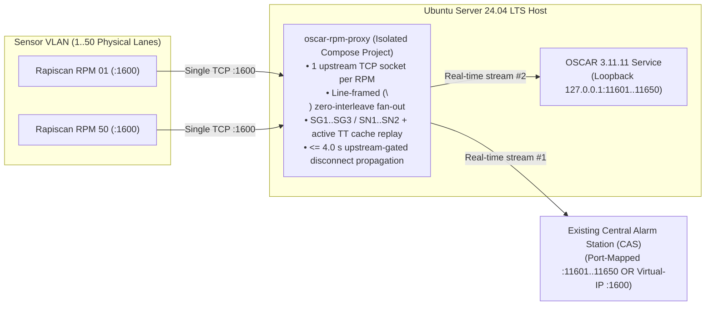

# OSCAR 3.11.11 Side-by-Side CAS Rapiscan RPM Real-Time Edge Proxy Guide (`oscar-rpm-proxy`)

This guide documents the optional **OSCAR Rapiscan RPM Real-Time Edge Proxy (`oscar-rpm-proxy`)** bundled in **OSCAR 3.11.11** for ports of entry and facilities where OSCAR is installed **side by side with an existing Central Alarm Station (CAS)** across **1 to 50+ Rapiscan Radiation Portal Monitors (RPMs)**.

---

## 1. Why Side-by-Side Installations Need an Edge Fan-Out Proxy

Rapiscan RPM controllers expose a single-client TCP data-stream listener (typically TCP port `1600`) that emits continuous `1 Hz` radiation count frames (`GA`, `GB`, `NB`, `NS`, `GX`), occupancy triggers, tamper alarms (`TT` / `TC`), and setup/daily reports (`SG1..SG3`, `SN1..SN2`). On standard controller firmware, **only one downstream TCP client can hold that socket at a time** — if OSCAR and an existing Central Alarm Station both connect directly to `:1600`, one system receives `Connection Refused` or causes connection flapping.

`oscar-rpm-proxy` solves this cleanly as an opt-in, isolated edge container (`compose.rpm-proxy.yaml`) in the OSCAR 3.11.11 release stack:



### Key Architectural Decisions

1. **Isolated Docker Compose Project (`--project-name oscar-rpm-proxy`):**
   - `oscar-rpm-proxy` runs outside the OSCAR JVM in its own Compose project (`compose.rpm-proxy.yaml`).
   - Running `sudo ./oscar.sh restart` or upgrading OSCAR (`sudo ./oscar.sh upgrade`) **never drops or interrupts the live TCP stream feeding the existing Central Alarm Station**. During `oscar upgrade`, OSCAR pre-stages the new `oscar-rpm-proxy` image without restarting the running proxy container; administrators can switch the proxy container image separately during a scheduled maintenance window via `sudo ./oscar.sh rpm-proxy upgrade`.
2. **Real-Time Throughput & Latency (Why Python 3.13 `asyncio` Needs No Language Rewrite):**
   - Each Rapiscan RPM transmits roughly `1–4` short ASCII lines per second (`~250–500 bytes/s`). Across **50 simultaneous RPMs** fanning out to **2 consumers (`100` downstream sockets)**, aggregate throughput is `~200–400 frames/s` (`~25–50 KB/s`) — purely socket I/O wait, not CPU compute.
   - Automated CI benchmarks (`tools/test-rpm-proxy.py`) verify `50` lanes × `2` consumers (`100` sockets) delivering `200` concurrent telemetry frames in **`~40 ms`** (`< 0.5 ms` per-frame fan-out latency, `< 2%` of a single vCPU core, `~28 MiB` RSS) with `TCP_NODELAY` enabled on both upstream and downstream sockets.
   - Keeping the proxy in pure Python 3.13 standard library (`python:3.13-alpine`, `~18 MiB` preloaded in `offline-images.tar`) preserves 100% air-gapped offline installation without external binary toolchains.
3. **Ubuntu Server 24.04 LTS Recommended for `10–50` Lanes:**
   - **Ubuntu Server 24.04 LTS** uses native Linux `network_mode: host` (`0` NAT proxies), supports multi-NIC sensor/operator VLAN isolation (`SO_BINDTODEVICE` / `source_ip`), and supports **Transparent Virtual-IP (`:1600` per lane)** as well as **Port-Mapped (`11601..11650`)** topologies for `1–50+` lanes.
   - **Windows 11 (Docker Desktop + WSL 2)** supports **Port-Mapped (`port-map`)** mode for smaller `1–12` lane sites; for `10–50` real-time side-by-side CAS lanes or Virtual-IP `:1600` addressing, deploy on Ubuntu Server 24.04 LTS.

---

## 2. How Real-Time RPM Disconnect Detection Works (`<= 4.0 s`)

A naive TCP proxy leaves its listening port open even when the physical RPM is unplugged — causing both the CAS and OSCAR to establish a TCP `SYN -> SYN-ACK` handshake with the proxy, see `"Connected"` briefly, drop, and flap endlessly instead of reporting a clean lane fault. Furthermore, an unplugged field Ethernet switch or frozen RPM controller stops sending packets **without** sending a TCP `FIN` or `RST`, which can leave a standard OS TCP socket appearing `"Connected"` for `15–120 minutes`.

`oscar-rpm-proxy` eliminates both failure modes per lane (`gate_listener_on_upstream: true`, `disconnect_clients_on_upstream_loss: true`, `idle_timeout_seconds: 4.0`, `first_line_timeout_seconds: 4.0`):

| Failure Scenario | What Happens on the Wire | CAS & OSCAR Detection Time |
| :--- | :--- | :--- |
| **RPM rebooted or service stopped (TCP `FIN`/`RST`)** | Proxy receives immediate upstream EOF/`RST`, closes that lane's downstream listener socket, and sends TCP `FIN` to CAS and OSCAR on that lane only. | **`< 50 ms`** |
| **Ethernet cable unplugged, field switch power loss, or frozen RPM firmware (silent drop — no `FIN`/`RST`)** | Because healthy Rapiscan RPMs emit `1 Hz` background/count lines continuously, `idle_timeout_seconds: 4.0` trips after `4.0 s` of silence, closes the upstream socket, closes that lane's downstream listener, and disconnects CAS and OSCAR. | **`<= 4.0 s`** |
| **While the RPM remains offline** | That lane's proxy listener stays **closed** (`listener_open: false`). Every reconnect attempt from CAS or OSCAR receives an immediate kernel TCP `RST` (**`Connection Refused`**) — identical to connecting directly to a powered-off RPM, with **zero `SYN-ACK` connect/disconnect flapping**. | Continuous `OFFLINE` / `DISCONNECTED` |
| **TCP port open on frozen RPM before emitting data** | `first_line_timeout_seconds: 4.0` keeps the downstream listener closed until the physical RPM emits at least one complete `\n`-terminated Rapiscan frame. | Zero false-healthy state |
| **Physical RPM recovers** | Proxy reconnects (`reconnect_delay_seconds: 2.0`), receives the first live telemetry frame, and immediately re-opens that lane's downstream listener so CAS and OSCAR auto-reconnect. | **`~2–3 s` after RPM recovery** |

In OSCAR Viewer, any disconnected lane immediately surfaces on the **Status of Health** page (identified by the **heart-pulse monitor icon** in the left navigation rail) and on the **Dashboard** (the **four-tile grid icon**).

---

## 3. Rapiscan Protocol-Aware Safeguards

1. **Newline (`\n`) Message Framing (`line_framed: true`):**
   - Buffers upstream bytes until `\n` (bounded by `max_line_bytes: 16384`) so a consumer connecting mid-packet never receives a half-line fragment (`810,0820\r\n`) that would trigger a checksum/parse fault.
2. **Setup & Active Tamper Cache Replay (`replay_rapiscan_setup: true`):**
   - Rapiscan RPMs emit `SG1`, `SG2`, `SG3` (gamma setup) and `SN1`, `SN2` (neutron setup) primarily on connect or midnight daily summary. `oscar-rpm-proxy` caches the latest valid `SG1..SG3` and `SN1..SN2` lines per lane (plus active `TT` tamper state, automatically cleared when `TC` arrives) and replays them immediately to any newly connecting consumer before streaming live `1 Hz` counts. On upstream disconnect, the cache is cleared so stale thresholds are never served across an RPM reconfiguration.
3. **Consumer-to-RPM Write Policy (`client_writes`):**
   - `discard` *(default)*: Safely drains and discards unexpected downstream client bytes so two consumers can never interleave commands onto the physical RPM socket.
   - `allow_primary`: Forwards upstream commands (such as clock-sync or setup poll) **only** from explicitly allowlisted `--primary-write-client <CAS_IP/32>` CIDRs while keeping OSCAR strictly read-only.
   - `forward`: Serializes writes from any allowed client under a per-lane async lock.
4. **Slow-Consumer Isolation (`queue_packets: 64`, `drain_timeout_seconds: 5.0`):**
   - Each consumer has an independent bounded send queue. If OSCAR or a secondary client stalls, `oscar-rpm-proxy` evicts only the stalled socket; the Central Alarm Station continues receiving every `1 Hz` frame with zero backpressure.

---

## 4. Choosing a Network Topology (`1–50` Lanes)

| Topology | Flag | How CAS Connects | How OSCAR Connects | Best When |
| :--- | :--- | :--- | :--- | :--- |
| **Topology A: Port-Mapped** *(Default, simplest)* | `--mode port-map --base-port 11601` | `<OSCAR_HOST_IP>:11601` .. `:11650` | `127.0.0.1:11601` .. `:11650` *(Ubuntu)* or `host.docker.internal:11601..11650` *(Windows)* | CAS allows configuring both IP and TCP port per lane. Zero extra IP addresses needed on the subnet. |
| **Topology B: Transparent Virtual-IP (`:1600`)** *(Ubuntu 24.04)* | `--mode virtual-ip --vip-start-ip <IP> --apply-vip-interface <NIC>` | `<VIP_1>:1600` .. `<VIP_50>:1600` *(standard port `1600` per lane!)* | `127.0.0.1:11601` .. `:11650` *(automatic dual loopback listener)* | Legacy CAS hardcodes TCP port `1600` and only permits changing each lane's IP address. |

> [!TIP]
> **Dual-NIC Isolation on Ubuntu Server 24.04 LTS:** On a 2-NIC server where NIC 1 (`enp1s0`) sits on the CAS / Operator LAN and NIC 2 (`enp2s0`) sits on an isolated Sensor VLAN with the physical RPMs, pass `--upstream-interface enp2s0` (or `--source-ip <SENSOR_NIC_IP>`). The proxy binds upstream sockets directly to the sensor interface while serving CAS on the operator interface.

---

## 5. Step-by-Step Commissioning Workflow

### Option A — Port-Mapped Mode (`11601..11650`, 1 Command from Existing OSCAR CSV)

Suppose you have an OSCAR 20-column lane spreadsheet (`site-lanes.csv`) listing the physical Rapiscan RPM IPs (`RPMConfigType=Rapiscan`, `RPMHost`, `RPMPort=1600`):

1. **Generate the proxy configuration AND the ready-to-import proxied OSCAR CSV, and start `oscar-rpm-proxy`:**

   ```bash
   sudo ./oscar.sh rpm-proxy configure \
     --from-csv /srv/oscar/seed/site-lanes.csv \
     --mode port-map \
     --base-port 11601 \
     --emit-oscar-csv /srv/oscar/seed/oscar-proxied-lanes.csv \
     --start
   ```

   *(Optional security hardening: restrict downstream connections to the CAS IP and local OSCAR host, and allow only the CAS IP to send commands to the RPMs:)*

   ```bash
   sudo ./oscar.sh rpm-proxy configure \
     --from-csv /srv/oscar/seed/site-lanes.csv \
     --mode port-map \
     --base-port 11601 \
     --allowed-client 127.0.0.1/32 \
     --allowed-client 198.51.100.50/32 \
     --client-writes allow_primary \
     --primary-write-client 198.51.100.50/32 \
     --emit-oscar-csv /srv/oscar/seed/oscar-proxied-lanes.csv \
     --start
   ```

2. **Point OSCAR at the local proxy ports:**
   - Import `/srv/oscar/seed/oscar-proxied-lanes.csv` (which preserves all 20 columns — cameras, coordinates, WebRelay I/O, EML flags — while rewriting `RPMHost` to `127.0.0.1` and `RPMPort` to `11601..11650`) via SensorHub Admin (`/sensorhub/admin`) or verify node connectivity in OSCAR Viewer under **Servers & Nodes** (**cloud icon** in the left navigation rail).
3. **Point the Central Alarm Station (CAS) at `<OSCAR_SERVER_IP>:11601..11650`.**

### Option B — Transparent Virtual-IP Mode (`:1600` per Lane on Ubuntu 24.04)

When the CAS requires standard TCP port `1600` for every lane, allocate an unused contiguous block of virtual IPs on the CAS/operator subnet (for example, `198.51.100.101` through `198.51.100.150` on `enp1s0/24`):

```bash
sudo ./oscar.sh rpm-proxy configure \
  --from-csv /srv/oscar/seed/site-lanes.csv \
  --mode virtual-ip \
  --vip-start-ip 198.51.100.101 \
  --vip-port 1600 \
  --vip-prefix 24 \
  --apply-vip-interface enp1s0 \
  --upstream-interface enp2s0 \
  --emit-oscar-csv /srv/oscar/seed/oscar-proxied-lanes.csv \
  --start
```

What `--apply-vip-interface` automates on Ubuntu Server 24.04 LTS:
- Performs an ARP duplicate-address check (`arping -D`) before claiming each virtual IP.
- Installs `/etc/sysctl.d/91-oscar-rpm-proxy-arp.conf` (`arp_announce=2`, `arp_ignore=1`) so Linux never answers ARP requests with the wrong secondary MAC/IP mapping.
- Installs and enables `/etc/systemd/system/oscar-rpm-proxy-vips.service` (`Before=docker.service`) so all `1–50` virtual IPs persist cleanly across host reboots.
- Binds `<VIP_N>:1600` for the CAS **and** `127.0.0.1:(11601 + N - 1)` for local OSCAR ingestion (`oscar-proxied-lanes.csv`).

---

## 6. Health Monitoring, Acceptance Testing & Lifecycle Commands

### CLI Reference (`oscar.sh` & `oscar.bat`)

```bash
# Inspect live per-lane upstream state, active consumer count, setup cache & idle timeouts
./oscar.sh rpm-proxy status

# Validate JSON syntax, port/endpoint uniqueness, and schema rules
sudo ./oscar.sh rpm-proxy validate

# Tail proxy container logs
sudo ./oscar.sh rpm-proxy logs --tail 200 --follow

# Controlled restart or container image upgrade during a maintenance window
sudo ./oscar.sh rpm-proxy restart
sudo ./oscar.sh rpm-proxy upgrade

# Disable proxy (and optionally remove secondary VIPs on Ubuntu)
sudo ./oscar.sh rpm-proxy disable --remove-vips
```

*(On Windows 11 small-site Port-Mapped deployments, run the matching `.\oscar.bat rpm-proxy configure -FromCsv ...`, `.\oscar.bat rpm-proxy status`, `.\oscar.bat rpm-proxy start|stop|restart|upgrade|disable` commands.)*

### Local HTTP Observability Endpoints (`127.0.0.1:9090` by Default)

- `GET http://127.0.0.1:9090/healthz` — Returns `200 OK` when the asyncio event-loop watchdog is healthy (`503` if stalled).
- `GET http://127.0.0.1:9090/readyz` — Returns `200 OK` when all upstream-gated lanes have live RPM telemetry and open downstream listeners (`503` when any lane is offline, listing `offline_lanes`).
- `GET http://127.0.0.1:9090/status` — Detailed per-lane JSON (`upstream_connected`, `listener_open`, `active_clients`, `lines_from_upstream`, `cached_setup_keys`, `idle_timeouts`, `reconnects`, `last_error`).
- `GET http://127.0.0.1:9090/metrics` — Prometheus exposition metrics (`oscar_rpm_proxy_upstream_connected`, `oscar_rpm_proxy_listener_open`, `oscar_rpm_proxy_active_clients`, `oscar_rpm_proxy_lines_from_upstream_total`, `oscar_rpm_proxy_idle_timeouts_total`).
- **Support Bundle Integration:** Running `sudo ./oscar.sh support-bundle` (or downloading a Support Bundle from the **Help (`?`)** dialog — **circled question-mark icon** in the top bar) automatically captures `rpm-proxy/config.json`, `status.json`, `metrics.prom`, and recent `rpm-proxy.log` entries.

### Mandatory On-Site Acceptance Checklist

1. **Simultaneous Feed Check:** Verify `./oscar.sh rpm-proxy status` reports `active_clients=2` on every proxied lane and that live `1 Hz` gamma/neutron counts increment identically on both the CAS console and OSCAR Viewer (**Dashboard** — **four-tile grid icon**, and **Lane View**).
2. **Physical Disconnect Test (`<= 4.0 s`):** Unplug one lane's RPM network cable (or disable its switch port) and confirm **both** the CAS and OSCAR Viewer (**Status of Health** — **heart-pulse monitor icon**) flag that lane `OFFLINE` within `4–5 seconds` with zero `Connected/Disconnected` flapping while unplugged. Reconnect the cable and confirm both systems recover automatically within `~3 seconds`.
3. **Zero-CAS-Drop OSCAR Restart Test:** Run `sudo ./oscar.sh restart` while watching the CAS console and confirm zero alarm or connection blips occur on the CAS during OSCAR's restart.
