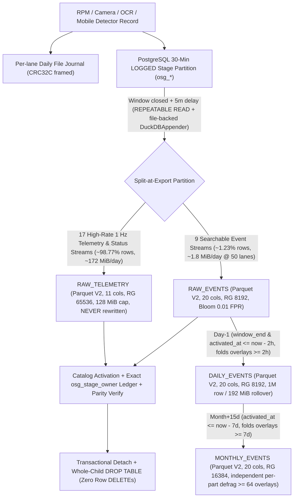

# OSCAR 3.12.2 storage architecture

OSCAR 3.12.2 separates live operational data, durable RPM source records, retained media, and
long-term observation history. PostgreSQL remains the authoritative hot store and metadata catalog;
immutable Apache Parquet V2 files carry the high-volume history using a **Split-at-Export +
Event-Only Multi-Tier Compaction** design. This keeps normal Open Sensor Hub (OSH) reads and
identities intact while eliminating telemetry write amplification (`1.0x` write-once storage for
`98.77%` of ingested rows) and keeping searchable operational event queries fast across multi-year
archives.

This guide describes the architecture. See [Data lifecycle](DATA_LIFECYCLE.md) for retention rules,
[archive format](ARCHIVE_FORMAT.md) for the portable file contract,
[backup and restore](BACKUP_RESTORE.md) for protection procedures, and
[storage operations](STORAGE_OPERATIONS.md) for the operator runbook.

Deployment and storage operation are supported only on Ubuntu Server 24.04 x86-64 and Windows 11
x86-64 with Docker Desktop/WSL 2. macOS is source/build-inspection only for this storage profile;
deployment and storage commands fail closed there.

## Design goals

- Preserve OSH system, datastream, feature-of-interest, and observation identities.
- Keep mutable/transactional records in PostgreSQL, and use PostgreSQL as bounded commit-durable
  staging for the allowlisted immutable detector outputs.
- Copy closed 30-minute batches of those eligible outputs to queryable ZSTD Parquet generations
  without locking the live tables or pausing ingestion.
- Capture the exact RPM input needed for a daily file before parsing can reject it.
- Retain exactly five independently decodable JPEGs from an aging alarm video, while keeping the
  legacy `videoPaths` field and source video during a rollback grace period.
- Make publication restartable and integrity-checkable by using immutable objects, checksums,
  durable job/catalog state, and commit markers.
- Make backup, restore, archival export, and irreversible deletion explicit operator workflows.

## Components and ownership

| Data | Primary location | Owner | Default lifecycle |
| --- | --- | --- | --- |
| Transactional records, OSH metadata, and 30-minute observation staging | PostgreSQL `postgres_data` volume | Tiered OSH database | All 26 operational and evidentiary observation streams (`gammaCounts`, `gammaThreshold`, `neutronCounts`, `setupGamma`, `setupNeutron`, `speed`, `backgroundReport`, `foregroundReport`, `status`, `emlContextual`, `emlScanContextual`, `emlAnalysis`, `dailyFile`, `connectionStatus`, `occupancyStatus`, `tamper`, `occupancy`, `adjudication`, `report`, `siteStatistics`, `nationalSummary`, `vehicleOcr`, `location`, `alarm`, `KromekDetectorRadiometricsV1Report`, `KromekSerialRadiometricStatusReport`) commit first to short-lived LOGGED 30-minute child relations (`osg_*`); after verified Parquet activation and exact parity the whole child is dropped, while `oscar_obs_latest`, `oscar_archive_schema` summary counters, `oscar_event_locator`, `oscar_obs_overlay` (for adjudicated archived occupancies), and datastream-scoped `oscar_tombstone` remain in PostgreSQL alongside static singleton configuration streams (`sensorLocation`, `adjudicationCodes`, `siteInfo`, ~52 rows total in `ONLY oscar.obs`) |
| Cold detector observations | `${OSCAR_ARCHIVE_DIR}` bind mount | Tiered OSH database and archive catalog | Immutable Parquet generation plus manifest and schema snapshot on an explicit host bind mount (preserving dedicated-disk attachability, `docker compose down -v` survival, and offline host backup/ACL verification); on Windows WSL 2 `9p`/`drvfs` mounts, `ParquetArchiveReader` maintains a disk-proportional (`2–8 GiB`) native `ext4` cache (`/var/lib/oscar/.cache/oscar-9p-parquet-cache`, excluded from backups) to avoid repeated `9p` read amplification |
| Daily-file source journal & Rapiscan daily setup sync | `files/.dailyfile-journal` and `config.json` in `oscar_state` | Daily File Journal service & `RapiscanConfigSaver` | Per-lane framed segments and publication ledger; private sealed segments expire after 30 days only after immutable-publication validation and exact frozen replay, with an optional additional backup gate. Rapiscan daily `SG1`–`SG3` and `SN1`–`SN2` setup records update `RapiscanConfig` in memory and coalesce changes into `config.json` asynchronously |
| Published daily files | `files/dailyfiles` in `oscar_state` | Daily File Journal service | Immutable legacy CSV plus versioned SHA-256 manifest |
| Current alarm video | `files/videos` in `oscar_state` | Bucket and OSCAR services | Five-JPEG conversion is immediately eligible after completion and begins asynchronously on a retention scan; source MP4 remains for 24 hours after verified publication (non-alarm clips are discarded immediately, or immediately after OCR when `alarmsOnly=false`) |
| Retained alarm media | `files/videos/retained-media/v1` in `oscar_state` | Retained-media backend | Exactly five JPEGs, manifest, and job ledger |
| Vehicle OCR evidence crops | `files/ocr/crops` in `oscar_state` | `VehicleOcrProcessor` & `StoragePressureRetention` | Optional per-lane OCR (`enabled=false` by default); date-partitioned JPEG crops (`files/ocr/crops/YYYY-MM-DD/`, ~2.3 KiB median) retained alongside `frame-03.jpg` (`ocrCropRetentionDays = 365` default, preserving held and operator-adjudicated occupancies and reclaiming eligible oldest crops under `85% -> 80%` storage pressure) |
| Reports, adjudication artifacts, sitemap | Bucket directories in `oscar_state` | Bucket and OSCAR services | Not deleted by cold-observation or storage-pressure maintenance |
| Legacy PostgreSQL WAL root | Preserved `${OSCAR_WAL_ARCHIVE_DIR}` host path, when present | Administrator legacy data | Not mounted or read by current restore; retained unchanged only to avoid destructive upgrade behavior, not a current PITR chain |
| Coordinated snapshot | Administrator-owned `${OSCAR_BACKUP_DIR}` host root | OSCAR storage CLI | Disabled by default; `single` mode uses an operator-selected safe absolute non-overlapping path and commits one verified snapshot through authenticated `CURRENT`; a separate physical drive is recommended, not required; never mounted into a long-running service |
| Container logs | Docker `json-file` storage | Docker | Size-rotated per service by Compose |

Paths beginning with `files/` are relative to OSCAR's persistent application directory inside the
container. Initialization writes absolute host paths under a stable sibling `oscar-storage`
directory into `.env`; a clean version-directory upgrade therefore reuses the same archive and
backup trees instead of silently attaching empty replacements. A legacy-WAL binding is retained
only so upgrades preserve an already existing compatibility tree. Site-specific alternatives must
also be absolute. The OSCAR service mounts only its cold archive at `/var/lib/oscar/archive`;
recovery media are deliberately not exposed to the long-running application. PostgreSQL uses
`archive_mode=off` and has no external WAL bind; a network-scoped one-shot `pg_basebackup` client
receives only the fresh staging directory for the recovery point it is creating. The administrator CLI otherwise accesses
backups through narrowly scoped one-shot containers, so no long-running service can modify the
backup root and none of these large trees is hidden in a Docker named volume.

The managed host roots are not interchangeable. Archive is the live service bind; backup storage is
exposed only to scoped one-shot helpers after manual `single`-mode opt-in. A pre-existing WAL root is
preserved as inactive compatibility data, but current setup does not create or claim it. Each active root carries an administrator-owned, no-follow
`.oscar-storage-root` version-1 identity binding its root kind to `OSCAR_DEPLOYMENT_ID` and recording
new creation or explicit legacy adoption. Live storage commands validate the applicable identities and
both deployment-owned named volumes before accessing data; the only exception is genuinely offline
`backup-verify` while mode is `single`. On Ubuntu, the archive root is root-owned mode `1770`; the
sticky bit prevents replacement of the root-owned marker. Backup storage
is root-only. Backups exclude these host-local identities, and
restore preserves and revalidates the target identities instead of trusting source markers.

Setup creates the exact named volumes `oscar_oscar_state` and `oscar_postgres_data` and labels new
volumes with the deployment UUID. The supported administration workflow validates ownership before
invoking Compose. Compose declares those names as external resources, so it does not create,
relabel, or offer to recreate them. A deliberately adopted pre-label volume is instead bound by its
deployment-specific adoption receipt and immutable Docker creation time.

PostgreSQL does not continuously archive WAL in this profile. Schema-v2 snapshots stream all WAL
needed by the online backup into `postgres/pg_wal`; `pg_verifybackup` validates that range.
Historical WAL publisher/merge helper files remain packaged only as unchanged contents of the
legacy release configuration. Verification authenticates a schema-v1 recovery point's required WAL
payload, but restore ignores it because streamed `postgres/pg_wal` is sufficient; no current flow
invokes a legacy publisher or merge helper, and OSCAR does not provide PITR.

## Write and query path



```text
Viewer/OSH query --> PostgreSQL hot stage + catalog-authorized Parquet V2/V1 candidates
                    --> overlays/tombstones --> de-duplicate (hot wins) --> order/limit
```

Catalog activation makes an `ACTIVE` generation queryable. In the shipping `PARQUET_PRIMARY`
profile, the worker re-hashes the Parquet object, proves exact row and UUID parity, and then
transactionally detaches and drops the complete staging child. There is no three-day duplicate-raw
overlap or row-wise staging deletion in this mode. The normal window, delay, clock-skew, and worker
budget totals at most 60 minutes, but this is an operational SLO rather than a hard deadline:
resource backlog, publication/parity failure, or an outage can extend PostgreSQL residency. The
generation then becomes `SEALED`;
both `ACTIVE` and `SEALED` generations are online query candidates. Confirmed cold purge first makes
a `SEALED` generation `DELETING` and non-queryable, then removes its files and ends in `PURGED`.

The direct journal and PostgreSQL observation path are deliberately separate. A journal append is
the durable source for a daily file; a parsed observation remains available to OSH clients. This
avoids reconstructing a regulatory/source artifact from an already-purged database.

### PostgreSQL hot store

The 3.12.0 database configuration uses sequential observation IDs, snapshots mutable OSH `DataBlock`
values when they are accepted, and commits a prepared-statement batch at 10,000 rows or the
configured `autoCommitPeriod` (one second in the standard configuration). The PostgreSQL JDBC
driver rewrites compatible batches into multi-row inserts. A statement-level transition-table
trigger updates each affected datastream's time range once per statement instead of once per
observation. An allowlisted immutable observation becomes durable staging only after that database
commit succeeds; the primary profile is not a direct-to-Parquet acknowledgement path.

Only a fresh schema created with explicit `PARQUET_PRIMARY` routes allowlisted detector rows into
short-lived LOGGED children. Those children keep only lean routing, export, and parity indexes; they
omit the generic observation-payload GIN and mutable-event indexes. Purpose-built event filter
indexes remain on the PostgreSQL parent because mutable occupancy/alarm records stay there.
Ordinary PostGIS stores, the `HOT_RETENTION` tiered mode, and already-created schemas are not
silently changed or stripped of an index.

The allocator raises its startup high-water from both live rows and every cataloged archive state
for the same store/scope. Archive activation and sealing take an exclusive transaction-scoped store
lock; observation batches and logical mutations take its shared form and then acquire affected
observation locks in ascending numeric order. File export stays outside that critical section. This
preserves public IDs and makes a hot-to-cold ownership transition atomic with concurrent writes,
overlays, tombstones, and stage retirement without introducing a global runtime mutex.

PostgreSQL remains the catalog of record for systems, datastreams, schemas, event locators,
archive generations, integrity receipts, overlays, tombstones, retention holds, deletion plans,
media references, and backup epochs. An archive object is not query-visible merely because a file
exists; it must be `ACTIVE` or `SEALED` in this catalog.

Each backup epoch stores only the canonical generation inventory's count, byte length, and
SHA-256. The exact sorted UUID list remains an HMAC-authenticated file in that recovery point.
Backup creation and verification stream the bounded list rather than constructing a PostgreSQL
UUID array, avoiding unbounded launcher memory and permanent per-backup TOAST growth while retaining
collision-safe identity and portable inspection.

New recovery points use backup schema v2 and omit the former cumulative WAL archive. They are built
as `<id>.partial`, verified before publication, and committed only when the launcher atomically
replaces the four-line HMAC-authenticated `CURRENT` pointer. The previous current snapshot remains
authoritative until that commit. Schema-v1 media retain an explicit compatibility verifier/restore
path and are never silently treated as v2.
The one-snapshot invariant is steady state: replacement temporarily needs space for old and new,
and the next locked command reconciles non-current debris only after authenticating both `CURRENT`
and the accepted schema-v2 contents selected for deletion. A finalized name or deletion-tombstone
name is not authorization by itself. Legacy schema-v1, failed, partial, unauthenticated, unaccepted,
and partially removed candidates are preserved with warnings. If no pointer exists, one uniquely
accepted schema-v2 recovery point is adopted by reconstructing authenticated `CURRENT`; multiple
accepted candidates are preserved and require operator review. Interrupted legacy deletion
tombstones are restored, while old uncommitted-v2 or incomplete deletion tombstones are preserved
because their remaining contents cannot prove deletion authorization. Unsafe or acceptance-invalid
`CURRENT` entries fail closed before cleanup.

Catalog schema v5 adds content-addressed `DataRecord` schema deduplication (`oscar_obs_schema_catalog`,
referenced via `schema_sha256` with `schema_json = NULL` in `oscar_obs_overlay` and
`oscar_obs_latest`), durable retention-hold resolution provenance, and makes holds part of the
logical mutation boundary. A removal holds the shared store/per-observation locks, takes a shared
hold-table lock in the same transaction, and materializes only exact observation holds plus held
generations whose ID blocks are candidates for that bounded ID set. CLI hold creation/release uses
a conflicting table-writer lock. This prevents archived tombstoning or cold purge from
racing a successful hold without loading every generation hold in the store.

### Parquet cold tier

Parquet is OSCAR's primary cold observation tier, not a backup. It depends on the PostgreSQL catalog,
overlays, tombstones, and application state and therefore must be captured with those components in
a coordinated snapshot. All 26 operational and evidentiary observation streams allowlisted in the
standard configuration (`gammaCounts`, `gammaThreshold`, `neutronCounts`, `setupGamma`,
`setupNeutron`, `speed`, `backgroundReport`, `foregroundReport`, `status`, `emlContextual`,
`emlScanContextual`, `emlAnalysis`, `dailyFile`, `connectionStatus`, `occupancyStatus`, `tamper`,
`occupancy`, `adjudication`, `report`, `siteStatistics`, `nationalSummary`, `vehicleOcr`,
`location`, `alarm`, `KromekDetectorRadiometricsV1Report`, `KromekSerialRadiometricStatusReport` —
with automatic upgrade promotion from the legacy 22-stream `v3.11.x` default list) are routed through
30-minute `osg_*` stage partitions and cold-tiered to ZSTD Parquet, leaving only static singleton
configuration streams (`sensorLocation`, `adjudicationCodes`, `siteInfo`, ~52 rows total) in
`ONLY oscar.obs`. When an archived `occupancy` is adjudicated, `AdjudicationControl` appends a new
`adjudication` observation and updates the archived `occupancy` via `oscar_obs_overlay` +
`oscar_obs_latest` without rewriting Parquet, while `oscar_tombstone` scopes tombstones by
`datastream_id` (with startup backfill of legacy `NULL` tombstones) so `resultTime=latest` pushdown
applies to any datastream without active overlays or tombstones. Meanwhile, `oscar_obs_latest` serves `< 0.5 ms`
`resultTime=latest` / `phenomenonTime=latest` queries for sparse streams, `oscar_archive_schema`
stores 26 per-generation, per-datastream summary counters (including per-category unadjudicated and
adjudicated Gamma, Neutron, and Gamma-Neutron alarm counters, `Fault - Neutron High` and Gamma/Extended-Occupancy
fault counters, and RS-350 `alarmCategoryCode = 'Gamma'` / `'Neutron'` counters) so `StatisticsOutput`,
`ReportDataAggregator`, and Dashboard/Event Log/StatusTable alarm, tamper, & fault counts sum interior
unmutated generations in SQL in `< 1 ms` and prune zero-match generations without opening Parquet files
(including exact disjoint cross-property `tamperStatus = true OR alarmState = 'Fault - ...'` pushdown).
Every summary lookup keeps `s.generation_id = ANY (?::uuid[])` chunked in `2,048`-UUID batches so
bounded `7d`/`15d`/`30d` windows stay strictly `O(window_size)` across 10 years (`175,200+`
`RAW_TELEMETRY` generations); pure event-stream queries restrict catalog scans via
`oscar_archive_generation_time_idx` to `EVENT_QUERY_PROFILES` (`RAW_GATED`, `RAW_EVENTS`,
`DAILY_EVENTS`, `MONTHLY_EVENTS`, verified per-stream to have no legacy telemetry generations); plain
unfiltered `LIMIT`-bounded reads slice `candidatesInitialClusters` by `row_count` so DuckDB opens only
the minimum prefix of Parquet files needed; nightly `reindexMutableTables()` bloat-gates
`oscar_archive_schema` once it exceeds `256 MiB` (`>= 50,000` dead tuples or `>= 10%` dead ratio); and
`PostgisCommandStoreImpl` prunes completed transient (`fileControl` / `hlsControl`, non-`adjudicationControl`)
commands older than 24 hours. On startup,
OSCAR reconciles existing `oscar_obs_storage_route` entries for all 26 allowlisted outputs to
`immutable=true`, reclaims empty expired or retired `osg_*` stage partitions, retroactively drains
and compacts (`VACUUM (FULL, ANALYZE) ONLY obs`) any legacy parent-table rows for newly-promoted
streams into verified Parquet generations, and backfills summary counters and `oscar_obs_latest` for
any pre-upgrade generations.

An asynchronous single-worker cycle starts immediately when the database module starts, then runs
every minute. In `PARQUET_PRIMARY`, allowlisted observations route to UTC-aligned, LOGGED 30-minute
staging children. A closed window becomes eligible after the five-minute safety delay. Detector
phenomenon times more than five minutes ahead of PostgreSQL's transaction clock are rejected so a
bad device clock cannot pin a future partition indefinitely. Ingestion always commits PostgreSQL
first and never waits for Parquet work; there is no direct-to-Parquet write path or
one-object-per-observation behavior. The 30 + 5 + 1 + 5 minute nominal window/delay/worker/skew
budget is at most 41 minutes and is required to remain at or below 60 minutes, but it is not a hard
deadline: resource admission, backlog, failure, and retry can delay publication. To catch up
without monopolizing the host, a cycle starts at most two generations, verifies at most two, retires
at most eight complete stage partitions, and stops starting new work after 15 minutes by default;
in-progress publication is allowed to finish safely. The exporter orders eligible unowned rows by phenomenon
time and observation ID and publishes deterministic bounded prefixes of that window. A prefix is
limited by `maximumRowsPerGeneration` (2,000,000 by default) and the lower of the operator's
`maximumUncompressedBytesPerGeneration` setting (2 GiB by default) or one eighth of the configured
DuckDB session memory (32 MiB with the standard 256 MiB session). Remaining rows are published as
same-window revisions during the current or a later cycle. If one row alone exceeds the effective
limit, the cycle fails closed and retains it in the LOGGED stage for operator action.

Before selecting new full-hour work, each cycle reclaims the exact bounds of the oldest eligible
latest-revision failed job (or an export left stale for two hours). This preserves retry identity
for sub-hour jobs produced by earlier releases and clears their durable failure state on upgrade.
An exact retry that has become empty is recorded as `SUPERSEDED`, so it cannot starve later windows.

The exporter uses a read-only PostgreSQL `REPEATABLE READ` transaction and does not update or lock
the selected rows while producing the files. PostgreSQL is fetched in 5,000-row pages while rows
stream directly into a file-backed DuckDB session via native `DuckDBAppender`, avoiding JDBC
multi-row SQL construction overhead and keeping Java heap bounded. In `PARQUET_PRIMARY` mode,
`OscarTieredObsSystemDatabase.runArchiveCycle()` first drains any pre-upgrade retryable `RAW_GATED`
job, then processes closed 30-minute UTC windows oldest-first by exporting each window's
complementary `RAW_EVENTS` and `RAW_TELEMETRY` generations back-to-back before advancing to the next
window (ensuring every staging child completes both profiles and retires immediately even during
backlog catch-up). Because `RAW_EVENTS` selects the 9 searchable event/summary streams via `JOIN`
and `RAW_TELEMETRY` selects the exact complement via `LEFT JOIN ... AND NOT (COALESCE(outputName,'') = ANY(...))`,
every staged row belongs to exactly one profile even if a datastream label is renamed later.
Each generation sorts observations by `(datastream_id, phenomenon_time, result_time, id_value)`,
writes ZSTD Parquet V2, verifies row count, ID range, and (for event profiles) projected columns
through DuckDB, writes a compressed datastream schema snapshot, and publishes the manifest last.
Catalog activation records exact ownership in `oscar_obs_stage_owner` and requires the owned count
and UUID set to equal the manifest. After every row in a stage child has an active, parity-verified
owner, the worker re-hashes the authoritative Parquet objects, transactionally detaches and drops
the complete child, clears its temporary ownership entries, and seals fully retired generations.
PostgreSQL therefore performs no large row-wise raw-data delete in `PARQUET_PRIMARY` mode.

Normal reads merge PostgreSQL staging and all catalog-authorized Parquet generations. PostgreSQL
wins during the brief verified transition when the same ID exists in both tiers. Archived updates are stored as small
PostgreSQL overlays, and archived deletes become PostgreSQL tombstones; immutable Parquet files are
not rewritten for individual mutations. If a live datastream schema is no longer present, the
generation's schema snapshot is used to decode its observations.

### Split-at-Export & Event-Only Multi-Tier Compaction

Measured 50-lane live production traffic (`~12.38M` rows/day on Ubuntu Server 24.04 LTS; `~1.43M` rows/day on a 6-lane Type A portal) is sharply bimodal:

| Workload Tier | Streams | Measured 50-Lane Volume (`6`-Lane Type A) | Typical Query Pattern | Storage Strategy |
| :--- | :--- | :--- | :--- | :--- |
| **High-rate telemetry, status & mobile (`RAW_TELEMETRY`)** | 17 streams: `gammaCounts`, `gammaThreshold`, `neutronCounts`, `dailyFile`, `connectionStatus`, `occupancyStatus`, `emlScanContextual`, `emlContextual`, `setupGamma`, `setupNeutron`, `speed`, `backgroundReport`, `foregroundReport`, `status`, `location`, `KromekDetectorRadiometricsV1Report`, `KromekSerialRadiometricStatusReport` | **`98.73%` of rows** (`12.22M` rows/day, **`226.0 MiB/day` = `80.6 GiB/yr`**, `4.71 MiB` per 30-min file, `19.4 B/row` ZSTD)<br>*(6-lane: `98.79%`, `1.41M` rows/day, **`24.6 MiB/day` = `8.8 GiB/yr`**, `525 KiB/file`)* | Narrow 15-second to 5-minute lane-inspection windows (`1–2` files opened) | **Write-once Parquet V2** (`archive_version = 2`, 11 base columns, `ROW_GROUP_SIZE = 65536`, `effectiveTelemetryExportUncompressedBytes = 128 MiB` at `256 MiB` DuckDB limit, `ocr_bloom = NULL`). **Exactly `1` file per 30m window (`48` files/day), `1.0x` write amplification, NEVER rewritten.** |
| **Searchable events & summaries (`RAW_EVENTS` -> `DAILY_EVENTS` -> `MONTHLY_EVENTS`)** | 9 streams: `occupancy`, `alarm`, `adjudication`, `report`, `vehicleOcr`, `emlAnalysis`, `tamper`, `siteStatistics`, `nationalSummary` | **`1.27%` of rows** (`156.9k` rows/day, **`7.0 MiB/day` raw -> `~1.5–2.0 GiB/yr` compacted**)<br>*(6-lane: `1.21%`, `17.3k` rows/day, `1.0 MiB/day` raw -> `~0.25–0.36 GiB/yr` compacted)* | Multi-week/multi-year Event Log, Dashboard, OCR container search, and adjudication queries | **Parquet V2 + Bloom + Event-Only LSM Compaction** (`archive_version = 2`, 20 columns = 11 base + 9 pre-extracted projected scalar columns `ocr_norm`, `occ_obs_id`, `event_id`, `adj_code`, `adj_count`, `gamma_alarm`, `neutron_alarm`, `max_gamma`, `max_neutron`, Split-Block Bloom filters at `0.01` FPR, 26 `oscar_archive_schema` summary counters, selective 256-byte `ocr_bloom` + `[ocr_min_norm, ocr_max_norm]` on `vehicleOcr`). |

Re-compacting `1 Hz` telemetry creates `2.0x` write amplification (`~806 GiB` of unnecessary NVMe rewrites over 10 years on 50 lanes), heavy background CPU/disk/WSL 2 `9p` I/O contention, and zero query-latency gain for 15-second event charts. Splitting at export time leaves telemetry permanent at `1.0x` write amplification while `ArchiveCompactionManager` compacts ONLY the compact `~1.27%` event tier:

1. **Tier-1 Live 30-Minute Split Export (`RAW_EVENTS` + `RAW_TELEMETRY`, `archive_version = 2`):**
   Keeps live PostgreSQL `osg_*` staging bounded under the `< 60` minute SLO while immediately
   giving recent `RAW_EVENTS` full Parquet V2 projected columns, Split-Block Bloom filters
   (`ROW_GROUP_SIZE = 8192`), and catalog OCR Bloom pruning before Day-1 compaction even runs.
2. **Tier-2 Day-1 Event Compaction (`RAW_EVENTS` -> `DAILY_EVENTS`, `archive_version = 2`):**
   Once a prior UTC day's `RAW_EVENTS` generations have both `window_end <= now - 2h` and
   `activated_at <= now - 2h` (with zero active retention holds, deletion plans, or unretired stage
   partitions), `ArchiveCompactionManager` compacts those `48` tiny event files (`~60 KiB` each)
   into `DAILY_EVENTS` (`ROW_GROUP_SIZE = 8192`, `~1.8 MiB` ZSTD on 50 lanes), folding settled
   `oscar_obs_overlay` rows (`updated_at <= now - 2h`) and recomputing exact summary counters,
   `oscar_obs_latest`, and `oscar_event_locator` mappings under 576-bit SHA-256 multiset parity.
3. **Tier-3 Mature Monthly Event Consolidation & Per-Part Defragmentation (`DAILY_EVENTS` -> `MONTHLY_EVENTS`, `archive_version = 2`):**
   Fifteen days after a UTC calendar month closes (with `DAILY_EVENTS.activated_at <= now - 7d`),
   OSCAR consolidates that month's `DAILY_EVENTS` files into `date=YYYY-MM-01/profile=MONTHLY_EVENTS/`
   (`ROW_GROUP_SIZE = 16384`, `~12` event files/year instead of `17,520`), and independently
   defragments any single `MONTHLY_EVENTS` part that accumulates `>= 64` settled overlays (`>= 7d` old).
4. **Explicit Rollover Ceilings, Bounded Memory, & Disjoint Windows:**
   Every compacted `DAILY_EVENTS` and `MONTHLY_EVENTS` part enforces explicit rollover ceilings
   (`effectiveCompactionPartMaxRows() = 1,000,000` rows and
   `effectiveCompactionPartUncompressedBytes() = 192 MiB` uncompressed = `~16–32 MiB` ZSTD Parquet,
   with a `2x` hard cap for pathological equal-timestamp bursts). Overlapping source generations are
   grouped (`clusterOverlappingSources`), streamed in `50,000`-row chunks, and spilled through
   `DuckDbResourcePolicy.ScratchDirectory` so JVM heap stays `< 20 MiB` and at most `1` DuckDB
   session is held at any instant. Rollovers cut on strict `phenomenon_time` boundaries so multi-part
   days or months receive strictly disjoint `[window_start, window_end)` intervals, preserving
   temporal catalog pruning and independent per-part defragmentation.
5. **Online-Backup Safety, Legacy Read-Only Compatibility, & Stale `.partial` Self-Healing:**
   Superseded event generations transition atomically to `DELETING` with `row_count = 0` and remain
   on disk for `compactionUnlinkGraceMinutes` (default `15` minutes) plus zero active reader pins so
   online `pg_basebackup` snapshots remain race-free. Legacy `3.11.x` `RAW_GATED` and pre-split
   `DAILY_TELEMETRY` generations remain transparently readable via `union_by_name = true` without
   triggering an upgrade rewrite storm. During `drainDeletingGenerations`, when no `EXPORTING` job
   is active, `sweepStaleUnregisteredPartials` removes unregistered `.partial` artifacts older than
   `2` hours (`7200` seconds) and prunes empty `profile=` / `date=` directories (failing closed on
   any UUID present in `oscar_archive_generation`) so `oscar.sh archive verify` stays self-healing.

#### Projected 50-Lane Steady-State Footprint (1-Year, 5-Year & 10-Year Horizon)

| Metric | Legacy Unsplit (`RAW_GATED` 30m) | Option A Split-at-Export + Event-Only Compaction (Measured & Projected) |
| :--- | :--- | :--- |
| Telemetry write amplification | `1.0x` (or `2.0x` if re-compacted daily) | **`1.0x` (written once, never rewritten — saves `~806 GiB` NVMe rewrites over 10 yrs)** |
| Event files per year (50 lanes) | `17,520` mixed files/year | **`~12` `MONTHLY_EVENTS` + `~30` `DAILY_EVENTS` + `<= 48` `RAW_EVENTS`** |
| Event files over 5 / 10 years (50 lanes) | `87,600` / `175,200` mixed files | **`~60` (`~8–10 GiB`) / `~120` `MONTHLY_EVENTS` (`~15–20 GiB` ZSTD total, all Bloom-indexed; `<= 198` event catalog rows via `EVENT_QUERY_PROFILES`)** |
| Telemetry files per day / 10-yr size (50 lanes) | `66–141` size-capped fragments/day | **`48` right-sized `4.71 MiB` `RAW_TELEMETRY` files/day (`80.6 GiB/yr` measured -> `~806 GiB` over 10 yrs; `~88 GiB` over 10 yrs on 6 lanes)** |
| `oscar_archive_schema` annual / 10-yr growth | High churn + dead-tuple bloat | Zero telemetry churn (`20,789` rows/day on 50 lanes = `~3.8 GiB/yr`, **`~38 GiB` over 10 yrs**; `2,371` rows/day on 6 lanes = `~0.42 GiB/yr`, **`~4.2 GiB` over 10 yrs**; `ocr_bloom = NULL` on telemetry, bloat-gated nightly reindex `>= 256 MiB`, chunked `ANY(?::uuid[])` at `<= 2,048`) |
| Certified 50-lane latencies (`277.5M` archived rows, `2.00M` occupancies) | `40–150 ms` latest/cold; `329 s` `StatisticsOutput` | **`7.2–9.9 ms` `latestArchivedMs`, `105–145 ms` `unboundedWindowNonArchivedMs`, `103–161 ms` `fiftyLaneBurstMs`, `17 s` `StatisticsOutput` (31-day 50-lane pass), `97 ms` Dashboard Next-Page, `580 ms` `off=1.5M` deep probe** |

#### Developer Anti-Regression Rules for Summary Pushdown & Cold Queries

When extending CQL filters, statistics, reports, or Parquet archive code:

- **Keep CQL strings and summary counters in strict lockstep:** Every CQL predicate executed by
  `StatisticsOutput` or `ReportDataAggregator` over high-volume streams (`gammaCounts`,
  `neutronCounts`, `occupancyStatus`, `alarm`) must resolve to an exact
  `JsonCqlEvaluator.SummaryCounterSpec` populated by both `ArchiveCatalog` and
  `ArchiveCompactionManager` and covered by unit tests in `TestArchiveLifecycleInvariants`. Even a
  single string mismatch (such as `"Fault - Neutron"` vs `"Fault - Neutron High"`) breaks summary
  pushdown for the entire `OR` filter (`faultCQL`), triggering 5-minute DuckDB full scans of 30 days
  of telemetry.
- **Guard nullable upgrade columns & keep `migrate()` / startup $O(1)$ (`< 60 s` datastore timeout):**
  Any new nullable column added to `oscar_archive_schema` must use
  `COALESCE(s.<col>, COALESCE(s.row_count, 0))` as its `upperBoundExpr` and
  `(s.summary_populated AND s.<col> IS NOT NULL)` as its `exactReadyExpr`.
  Because `ModuleRegistry.loadAllModules` enforces a hard `60-second` datastore
  startup timeout, **never** run unbounded full-table `UPDATE oscar_archive_schema`
  or multi-generation DuckDB scans synchronously inside `ArchiveCatalog.migrate()`
  or `OscarTieredObsStore` startup: gate inline backfills to `<= 64` generations
  and drain larger multi-week/multi-year upgrades newest-first in bounded committed
  batches (`backfillPendingSchemaUpgradeColumnsBatch(128)` combining schema-blob
  zero-fills into one pass per batch, then targeted DuckDB
  `read_parquet(..., filename=true, union_by_name=true)` registered in
  `DuckDbResourcePolicy.AdmissionController.isBackgroundCountOperation`) on the
  `oscar-base-summary-backfill` daemon thread, latching completed phases via the additive
  `summary_backfill_flags` bitmask on `oscar_archive_generation` (`SCHEMA_VERSION = 5`, zero
  growing indexes, `< 1 ms` caught-up steady-state probe) and writing compact
  `summary_version = 2` metadata without full-table rescans.
- **Keep DuckDB interactive headroom, overlay maintenance, and PostgreSQL `/dev/shm` bounded:**
  During archive export and background scans, `DuckDbResourcePolicy` reserves one interactive
  DuckDB permit (`activeLifecycleCount` capped below the 2-session global ceiling) so user queries
  are never starved behind background jobs; bloat-gated online `oscar_obs_overlay` maintenance and
  tightened catalog/overlay autovacuum keep hot tables compact without `ACCESS EXCLUSIVE` locks;
  all programmatic `VACUUM` statements emit `VACUUM (ANALYZE, PARALLEL 0)` paired with
  `shm_size: 256m` on `oscar-postgres-1` so PostgreSQL 16 parallel maintenance never exhausts
  Docker's default `64 MiB` `/dev/shm`.
- **Cold-archive telemetry storage-pressure protection (`telemetryPressureEnabled = true`):**
  When archive filesystem usage reaches `85%` (target `80%`), the lifecycle worker reclaims oldest
  write-once `RAW_TELEMETRY` / `DAILY_TELEMETRY` generations older than `365 days` (or `30 days`
  at `>= 92%` critical usage, up to `24` generations/cycle, subtracting pending `DELETING` bytes)
  through reader-pin-safe `DELETING -> drainDeletingGenerations()`, while preserving **100%** of
  `RAW_EVENTS`, `DAILY_EVENTS`, `MONTHLY_EVENTS`, `RAW_GATED`, active `oscar_retention_hold` rows,
  and `oscar_obs_latest`.
- **Version persisted `base_summary_mask` bits:** New `JsonCqlEvaluator.computeSummaryMask` bits
  must be gated behind a version bit (`BIT_MASK_V2 = 1 << 30`) so pre-upgrade persisted masks on
  `oscar_obs_overlay` and `oscar_tombstone` never silently mis-evaluate new predicates.
- **Always pass `union_by_name=true` across mixed generations:** Multi-file DuckDB reads can combine
  11-column (`RAW_GATED`, `RAW_TELEMETRY`) and 20-column (`RAW_EVENTS`, `DAILY_EVENTS`,
  `MONTHLY_EVENTS`) Parquet files in the same batch.
- **Stage `9p`/`drvfs` Parquet files before DuckDB reads on Windows 11 + WSL 2:** Every DuckDB path
  reading `/var/lib/oscar/archive` must check `ParquetArchiveReader.isPathOn9pMount(...)` and stage
  into the local Linux `ext4` `operationDirectory` (via 16 KiB bounded reads in
  `ArchiveExporter.stageToLocalDirectory`) so DuckDB native `pread` never hits WSL 2 `9p` `ENOMEM`.

For an explicit set of datastreams with `resultTime=latest` and no sparse mutation records, OSCAR
pushes latest-per-stream selection into both tiers before the union. PostgreSQL performs one
backward index probe per requested stream and DuckDB returns one catalog-authorized cold candidate
per stream; the union then chooses the newer candidate. The PostgreSQL probe treats a null result
time as older than every non-null result time and uses the greatest observation ID as the stable
tie-breaker, matching the cold reader and final union without scanning the stream's history. The
fallback deliberately reads the full eligible history when overlays or tombstones exist, because
dropping an invalidated newest row must reveal the preceding observation rather than incorrectly
reporting no state. The Viewer additionally limits health requests to ten stream IDs and two
concurrent batches, so a large hot table cannot turn one slow multi-stream query into an all-lanes
`Waiting` display.

DuckDB is embedded in OSCAR for archive reads. There is no required FDW, archive server, or external
query service. An exported generation can also be inspected with ordinary DuckDB or other Parquet
tools; see [Archive format](ARCHIVE_FORMAT.md).

Every embedded DuckDB connection—export, post-write verification, activation staging, hot/cold
parity, cold result streaming, metadata scans, and counts—uses the same bounded
resource policy. The 3.12.0 production defaults are 256 MiB of DuckDB memory, two worker threads,
and 4 GiB of spill per operation, with at most two embedded sessions admitted process-wide. A
fair first-in/first-out gate waits up to 30 seconds and then fails busy; all independently
configured archive stores share the gate, and the smallest cap registered by an active or waiting
store governs admission. This prevents overlapping queries and background jobs from multiplying
the per-session native-memory and spill envelopes without bound. Each admitted operation receives
a new unguessable child beneath `/var/lib/oscar/duckdb-tmp`; the connection is closed before that
child is recursively removed. The first embedded DuckDB session in a process also acquires and
holds an operating-system lease at `/var/lib/oscar/duckdb-tmp/.oscar-duckdb.lock`. The lease is a
real, non-symbolic-link regular file with POSIX mode `0600`; it prevents a second process or
classloader from treating live operation directories as abandoned. While holding that lease,
first-open recovery removes only direct child directories whose names match OSCAR's canonical
`<operation>-<lowercase UUID>` form. It never follows symbolic links or removes unrelated entries.
Streaming archive readers check cancellation between rows as well as cancelling the active JDBC
statement, so shutdown can interrupt both a blocked DuckDB call and result iteration. A hard process
failure can leave operation children, but the next successful owner reclaims those recognized
children before opening a session.
OSCAR rejects a scratch root that contains, equals, or is contained by the immutable archive root.
On POSIX filesystems both the scratch parent and operation child must be mode `0700`; the lease must
be mode `0600`. Existing broader permissions are rejected instead of silently changing
administrator-managed permissions. The
Linux container used on both Ubuntu and Windows supplies these POSIX semantics. A non-container,
non-POSIX embedding must enforce an equivalent owner-only ACL. The spill directory is excluded
from coordinated backups. Because that exclusion is deliberately exact, the only permitted scratch
path inside persistent `/var/lib/oscar` state is `/var/lib/oscar/duckdb-tmp`; a custom scratch path
must be outside `/var/lib/oscar` and remain disjoint from the archive.

### Direct daily-file journal

Rapiscan data is journaled before CSV parsing, RS350 N42 data before XML normalization/parsing, and
Aspect data immediately after its register snapshot is rendered. Each record is appended
synchronously to its lane's `.open` segment as a length, CRC32C, timestamp, and exact UTF-8 payload.
The default durability bounds are one second, 128 records, or 1 MiB between forces, whichever is
reached first.

Driver capture is enabled and required by default. If the journal service cannot start, a required
driver does not start. If a required append fails, the driver stops its reader instead of silently
continuing without the source record. At day rollover, the service publishes the legacy CSV and a
SHA-256 manifest atomically and marks the ledger `PUBLISHED` only after both verify.

Journal service readiness is independent of historical backlog size. Current-day crash recovery is
performed before that lane's first new append; older days are recovered in bounded background
batches, including for lanes already receiving a newer day. Complete durable publications are not
re-rendered during a normal restart, avoiding the prior startup CPU/I/O spike and RPM timeout race.

Compatibility observations are removed only for completed local-day windows whose ledger,
manifest, CSV identity, and current CSV checksum all validate. The exact-midnight cleanup is an
initial bounded attempt; the hourly maintenance task reruns the same oldest-first catch-up so a
lane published just after midnight is retried without waiting another day. Current unsealed-day
rows are never compacted merely to retain a latest value.

The full journal contract is maintained in the modules repository at
[`include/osh-oakridge-modules/docs/daily-file-journal-v1.md`](https://github.com/ORNL/osh-oakridge-modules/blob/main/docs/daily-file-journal-v1.md).

### Five-frame retained media

With the standard zero-day retention age, a completed camera clip is immediately eligible and is
processed asynchronously by the next bounded retained-media lifecycle cycle. It is decoded and
sampled at `FIRST`, `QUARTER`, `MIDDLE`, `THREE_QUARTERS`, and `LAST`. The five selections must be
distinct decoded frame ordinals. Each output is an opaque baseline sRGB JPEG; default quality is
85. Frames are written, forced, decoded and verified independently, then a typed manifest is
published as the set's commit marker.

The manifest lane identity is always the containing OSH lane-system UID
(`urn:osh:system:lane:*`), not the child RPM UID that owns the occupancy datastream. Resolution
walks the standard OSH system-parent relationship supplied by the active datastore and fails closed
if no authoritative lane is available; OSCAR does not publish an `unknown-lane` or child-system
substitute.

New OSCAR camera recordings are published only after at least five video packets have been muxed.
If an alarm ends sooner, the recorder collects a bounded post-roll before closing its hidden
partial. This preserves the distinct-frame evidence contract without lengthening the occupancy.

The source MP4 is kept for 24 hours by default after successful publication. A later idempotent pass
deletes it only if the complete media set still verifies and no hold is active. A corrupt clip, a
legacy or externally supplied clip with fewer than five decoded frames, or any write/verification
failure leaves the MP4 intact.
The occupancy's legacy `videoPaths` value is not rewritten. The Viewer asks the authenticated media
API for the five-frame set and falls back to legacy video playback on `404`. Before decoding images,
the Viewer applies a 1 MiB streaming catalog limit plus bounded camera-count, frame-byte, dimension,
pixel, and event-wide budgets. Asset bodies are also stopped at their manifest byte limit. It
then fetches only each camera's selected frame and admits at most three frame requests concurrently,
so an event with several cameras does not create an eager memory or network burst.

The complete media contract is maintained at
[`include/osh-oakridge-modules/docs/retained-media-v1.md`](https://github.com/ORNL/osh-oakridge-modules/blob/main/docs/retained-media-v1.md).

## Integrity and failure boundaries

The storage layers use the same publication pattern:

1. Write a hidden or `.partial` object in the destination directory.
2. Force file contents to stable storage.
3. Reopen and verify structure, counts, dimensions, or checksum as appropriate.
4. Rename into place; daily-file and media stores require same-directory atomic rename.
5. Publish the manifest or catalog transition last.

Incomplete files are therefore not normal read candidates. Complete corruption is fail-visible:
the system preserves the original source or staging data and records/logs the failure. Archive readers
also verify a Parquet object's SHA-256 before first use in the process. Operators must investigate a
missing or mismatched catalog object; they must not remove its catalog row to hide the error.

## Performance characteristics

The design reduces the two largest historical sources of PostgreSQL work: individual insert
transactions/range-trigger updates and indefinite storage of high-frequency detector counts.
Batching lowers transaction and WAL overhead, while Parquet provides columnar compression and
min/max row-group pruning for bounded archive searches. Event, adjudication, reporting, and recent
telemetry workflows remain on the hot path.

Archiving and media conversion are intentionally background work and still consume CPU and I/O.
Each archive generation is bounded, and a catch-up cycle starts no more than two generations or 15
minutes of new work by default; parity verification is bounded at two generations and physical
stage retirement at eight partitions per cycle. Media extraction decodes one source twice to make time-positioned,
independently decodable JPEGs. Provision spare capacity and measure the site under
its real lane/camera rate before accepting whole-stage retirement. See
[Storage operations](STORAGE_OPERATIONS.md#capacity-and-performance-monitoring).
The media scanner opens its PostgreSQL reads inside a worker-scoped cancellation boundary and
checks interruption between bounded maintenance entries. A supported stop therefore cancels only
that scanner's statements and waits for its thread to finish before PostgreSQL is stopped.

## Security and privacy

Detector observations, vehicle/alarm images, adjudications, reports, and daily records may be
sensitive operational data. Apply the same access, retention, incident-response, and legal-hold
policy to hot, cold, exported, and backup copies.

- The archive directory is a long-lived service bind. The opt-in backup directory is an
  administrator-owned host root used only through scoped one-shot helpers. Preserve any legacy WAL
  root without mounting it into PostgreSQL. Restrict host access and include the applicable roots in
  disk encryption, monitoring, and endpoint protection.
- The retained-media API is authenticated, read-only, enforces the `videos` bucket GET permission,
  and does not expose internal job/catalog paths. It is not a public image server.
- Deployment credentials and TLS private material are encrypted in a coordinated backup with
  AES-256-CBC/PBKDF2. The encrypted `secrets/` payload contains a recovery copy of the backup-key
  file, but there is no usable plaintext key in the backup: an independently protected external
  copy is still required to decrypt that payload.
- Parquet exports and copied JPEGs are intentionally portable. A copy outside OSCAR no longer has
  OSCAR authorization controls; encrypt it, control recipients, and record its destruction.
- Do not include secrets, full manifests, raw records, or images in ordinary support tickets or
  unredacted diagnostic bundles.

## 3.12.0 compatibility boundary

OSCAR 3.12.2 is a substantial storage-profile update. A new installation uses:

- `OscarTieredObsSystemDatabaseConfig` with explicit `PARQUET_PRIMARY`, sequential IDs, and batched
  commit-durable PostgreSQL staging for the allowlisted immutable outputs;
- a compact short-lived exact-owner ledger for staging plus a versioned archive catalog;
- a required direct daily-file journal for Rapiscan, Aspect, and RS350 drivers;
- exact-five JPEG retained media rather than keyframe-only MP4 reduction; and
- PostgreSQL data checksums, `archive_mode=off`, an external Parquet archive bind, and an optional
  administrator-owned single-snapshot backup root in the release deployment.

The legacy occupancy `videoPaths` field, legacy daily CSV syntax, and OSH identities are retained.
However, an existing deployment's persistent `config.json` is intentionally not overwritten by
`oscar upgrade`, and PostgreSQL data checksums are selected only when a new database cluster is
initialized. There is no automatic conversion of an old database/configuration into the complete
3.12.0 storage profile. The corrected 3.12.0 observation natural-key index also treats null fields as
equal; index creation fails safely if a legacy database contains duplicates under that definition,
and those rows require an explicit reviewed migration decision. Natural-key verification uses the
same `COALESCE` expressions as the unique index, including for null fields, so PostgreSQL generic
prepared plans can probe the complete key instead of scanning every row for a datastream.
Exact natural-key replays are no-ops, while corrected values retain the original OSH observation
ID. If the observation is already archive-owned, OSCAR writes the correction to the immutable
generation's PostgreSQL overlay—both during the brief verified staging transition and after the staging child has been dropped—
instead of modifying Parquet or inserting a duplicate hot identity.

For the current test systems and for new production deployments, initialize a fresh 3.12.0 database
and configuration. For a production system whose history must be preserved, keep the old deployment
read-only, take and verify a backup, export records required by policy, and perform a separately
validated migration rather than deleting volumes or assuming `upgrade` enabled the new lifecycle.
The staged rollout in [Storage operations](STORAGE_OPERATIONS.md#production-rollout) validates
whole-partition retirement only after archive parity and a restore drill pass.
